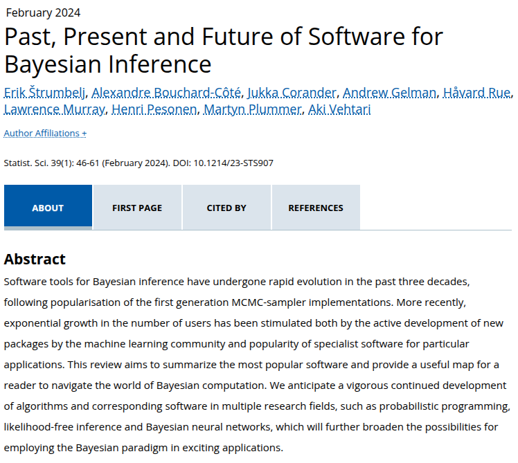
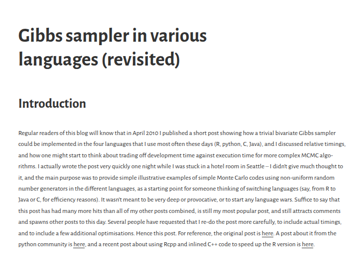
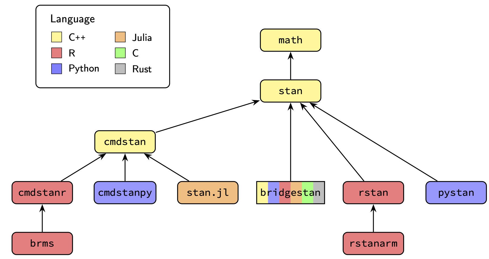
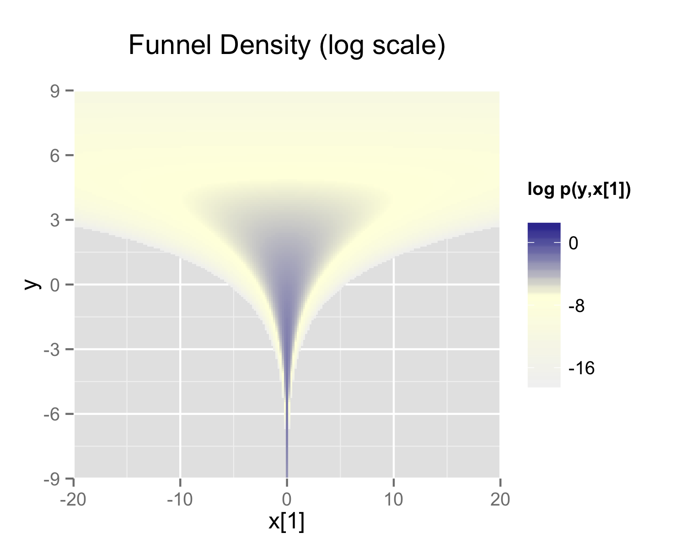

```{r setup}
#| include: false
## Code chunks on the slides are not run when knitting: each is meant to be run
## interactively (see each approach's second slide for what to install).
## Timings and estimates come from reading_group_20261113_results.rds, which the
## runner chunk below regenerates when knitting with params$rerun = TRUE.
knitr::opts_chunk$set(eval = FALSE, size = "tiny")
knitr::knit_hooks$set(size = function(before, options, envir) {
  if (before) paste0("\\", options$size) else "\\normalsize"
})
res <- if (file.exists("reading_group_20261113_results.rds")) {
  readRDS("reading_group_20261113_results.rds")
}
## these run their 4 chains one after another: their sampling time is divided by 4,
## as if the chains ran in parallel (ideal speed-up; compilation is not divided)
sequential <- c("glmm-jags", "glmm-nimble", "glmm-cpp",
                "mix-jags", "mix-nimble", "mix-monty", "mix-cpp")
if (!is.null(res)) {
  i <- res$methods$method %in% sequential
  res$methods$t_total[i] <- res$methods$t_total[i] - 3 / 4 * res$methods$t_fit[i]
  res$methods$t_fit[i] <- res$methods$t_fit[i] / 4
  i <- res$summary$method %in% sequential
  res$summary$t_fit[i] <- res$summary$t_fit[i] / 4
}
## total time (default) or fitting time of a method, in seconds
secs <- function(method, what = c("t_total", "t_fit")) {
  what <- match.arg(what)
  x <- res$methods[res$methods$method == method, what]
  if (length(x) != 1 || is.na(x)) "?" else format(signif(x, 2), big.mark = ",")
}
## posterior mean (default) or sd of a variable under a method
est <- function(method, variable, what = c("mean", "sd"), digits = 2) {
  what <- match.arg(what)
  x <- res$summary[res$summary$method == method & res$summary$variable == variable, what]
  if (length(x) != 1 || is.na(x)) "?" else format(round(x, digits), nsmall = digits)
}
ess <- function(method, variable) {
  x <- res$summary[res$summary$method == method & res$summary$variable == variable, "ess_bulk"]
  if (length(x) != 1 || is.na(x)) "?" else format(round(x, -1), big.mark = ",")
}
n_chick <- length(unique(ChickWeight$Chick))
```

```{r runner}
#| include: false
#| eval: !expr isTRUE(params$rerun)
## Regenerates reading_group_20261113_results.rds, which the slides read for their
## inline numbers and comparison plots, by running the slides' own code chunks:
##   rmarkdown::render("reading_group_20261113.Rmd", params = list(rerun = TRUE))
##   ... params = list(rerun = TRUE, force = TRUE)    # ignore the cache
## Each example runs in a fresh R session (so timings include package loading and
## compilation) and needs the packages on its slide; one whose packages are not
## installed is recorded as "not installed". Each job is cached in
## reading_group_20261113_cache/<job>.rds with a hash of its code, and rerun only
## when that code changes. Takes about 25 minutes from scratch.
run_all <- function(chunks, dir, force = FALSE) {
  setwd(dir)
  cache_dir <- "reading_group_20261113_cache"
  out_file <- "reading_group_20261113_results.rds"
  n_keep <- 2000  # draws kept per method for the density plots
  variables_of_interest <- c("mu_a", "mu_b", "sigma_a", "sigma_b", "sigma_e",
                             "mu1", "mu2", "sigma1", "sigma2", "p")

  ## ---- chunks ---------------------------------------------------------------
  ## code of each labelled chunk in the Rmd, with its engine
  read_chunks <- function(file) {
    x <- readLines(file)
    starts <- grep("^```\\{(r|Rcpp) ", x)
    chunks <- list()
    for (s in starts) {
      engine <- sub("^```\\{(r|Rcpp) .*$", "\\1", x[s])
      label <- sub("^```\\{(r|Rcpp) ([^,}]+).*$", "\\2", x[s])
      e <- s + which(x[(s + 1):length(x)] == "```")[1]
      chunks[[label]] <- list(engine = engine, code = x[(s + 1):(e - 1)])
    }
    chunks
  }

  ## ---- jobs -----------------------------------------------------------------
  ## Each job runs some chunks in order, then `extract`, which must create
  ## `.out`: a named list (by method) of list(draws = <draws_df>, t_fit = <s>).
  ## `methods` gives each method's model, label and type.
  ## Helpers available to `extract`: .mk() builds a draws_df from a data frame
  ## and chain ids; .gauss() draws from a Gaussian approximation.
  job <- function(chunks, packages, methods, extract) {
    list(chunks = chunks, packages = packages, methods = methods, extract = extract)
  }
  method <- function(model, label, type) list(model = model, label = label, type = type)
  MCMC <- "MCMC"; LAPLACE_MCMC <- "Laplace + MCMC"; DETERMINISTIC <- "Deterministic"

  jobs <- list(
    ## GLMM ---------------------------------------------------------------------
    "glmm-jags" = job(
      c("glmm-jags-model", "glmm-jags-fit"), "rjags",
      list("glmm-jags" = method("glmm", "JAGS", MCMC)),
      '.out <- list("glmm-jags" = list(draws = posterior::as_draws_df(draws), t_fit = t_fit[["elapsed"]]))'),
    "glmm-nimble" = job(
      c("glmm-nimble-model", "glmm-nimble-fit"), "nimble",
      list("glmm-nimble" = method("glmm", "NIMBLE", MCMC)),
      '.out <- list("glmm-nimble" = list(draws = posterior::as_draws_df(draws), t_fit = t_fit[["elapsed"]]))'),
    "glmm-stan" = job(
      c("glmm-stan-model", "glmm-stan-fit"), "cmdstanr",
      list("glmm-stan" = method("glmm", "Stan", MCMC)),
      '.out <- list("glmm-stan" = list(draws = fit$draws(c("mu_a", "mu_b", "sigma_a", "sigma_b", "sigma_e"),
                                                       format = "draws_df"), t_fit = t_fit[["elapsed"]]))'),
    "glmm-brms" = job(
      "glmm-brms", c("brms", "cmdstanr"),
      list("glmm-brms" = method("glmm", "brms", MCMC)),
      'd <- posterior::rename_variables(posterior::as_draws_df(fit), mu_b = b_Intercept, mu_a = b_Time,
                                         sigma_b = sd_Chick__Intercept, sigma_a = sd_Chick__Time,
                                         sigma_e = sigma)
       .out <- list("glmm-brms" = list(draws = d, t_fit = t_fit[["elapsed"]]))'),
    "glmm-rstanarm" = job(
      "glmm-rstanarm", "rstanarm",
      list("glmm-rstanarm" = method("glmm", "rstanarm", MCMC)),
      'd <- posterior::as_draws_df(as.array(fit)); v <- posterior::variables(d)
       vb <- grep("^Sigma\\\\[.*\\\\(Intercept\\\\),\\\\(Intercept\\\\)\\\\]", v, value = TRUE)
       va <- grep("^Sigma\\\\[.*Time,Time\\\\]", v, value = TRUE)
       d <- .mk(data.frame(mu_b = d[["(Intercept)"]], mu_a = d[["Time"]], sigma_a = sqrt(d[[va]]),
                           sigma_b = sqrt(d[[vb]]), sigma_e = d[["sigma"]]), d$.chain)
       .out <- list("glmm-rstanarm" = list(draws = d, t_fit = t_fit[["elapsed"]]))'),
    "glmm-tmb" = job(
      c("glmm-tmb-model", "glmm-tmb-fit"), "TMB",
      list("glmm-tmb" = method("glmm", "TMB (Laplace, mode)", DETERMINISTIC)),
      'x <- .gauss(sdr$par.fixed, sdr$cov.fixed)
       d <- .mk(data.frame(mu_a = x[, "mu_a"], mu_b = x[, "mu_b"], sigma_a = exp(x[, "log_sigma_a"]),
                           sigma_b = exp(x[, "log_sigma_b"]), sigma_e = exp(x[, "log_sigma_e"])))
       .out <- list("glmm-tmb" = list(draws = d, t_fit = t_fit[["elapsed"]]))'),
    "glmm-tmbstan" = job(
      "glmm-tmbstan", c("RTMB", "tmbstan"),
      list("glmm-tmbstan" = method("glmm", "tmbstan + RTMB", MCMC)),
      'd <- posterior::mutate_variables(posterior::as_draws_df(as.array(fit)), sigma_a = exp(log_sigma_a),
                                         sigma_b = exp(log_sigma_b), sigma_e = exp(log_sigma_e))
       .out <- list("glmm-tmbstan" = list(draws = d, t_fit = t_fit[["elapsed"]]))'),
    "glmm-glmmtmb" = job(
      "glmm-glmmtmb", "glmmTMB",
      list("glmm-glmmtmb" = method("glmm", "glmmTMB (ML)", DETERMINISTIC)),
      'p <- fit$sdr$par.fixed; x <- .gauss(p, fit$sdr$cov.fixed)
       beta <- which(names(p) == "beta"); theta <- which(names(p) == "theta")
       d <- .mk(data.frame(mu_b = x[, beta[1]], mu_a = x[, beta[2]], sigma_b = exp(x[, theta[1]]),
                           sigma_a = exp(x[, theta[2]]), sigma_e = exp(x[, names(p) == "betadisp"])))
       .out <- list("glmm-glmmtmb" = list(draws = d, t_fit = t_fit[["elapsed"]]))'),
    "glmm-monty" = job(
      c("glmm-monty-model", "glmm-monty-fit"), "monty",
      list("glmm-monty" = method("glmm", "monty", MCMC)),
      '.out <- list("glmm-monty" = list(draws = draws, t_fit = t_fit[["elapsed"]]))'),
    "glmm-cpp" = job(
      c("glmm-cpp-sampler", "glmm-cpp-fit"), "Rcpp",
      list("glmm-cpp" = method("glmm", "Custom C++", MCMC)),
      '.out <- list("glmm-cpp" = list(draws = posterior::as_draws_df(draws), t_fit = t_fit[["elapsed"]]))'),
    ## mixture ------------------------------------------------------------------
    "mix-jags" = job(
      c("mix-jags-model", "mix-jags-fit"), "rjags",
      list("mix-jags" = method("mix", "JAGS", MCMC)),
      '.out <- list("mix-jags" = list(draws = .rename_mix(posterior::as_draws_df(draws)), t_fit = t_fit[["elapsed"]]))'),
    "mix-nimble" = job(
      c("mix-nimble-model", "mix-nimble-fit"), "nimble",
      list("mix-nimble" = method("mix", "NIMBLE", MCMC)),
      '.out <- list("mix-nimble" = list(draws = .rename_mix(posterior::as_draws_df(draws)), t_fit = t_fit[["elapsed"]]))'),
    "mix-stan" = job(
      c("mix-stan-model", "mix-stan-fit"), "cmdstanr",
      list("mix-stan" = method("mix", "Stan", MCMC)),
      '.out <- list("mix-stan" = list(draws = .rename_mix(fit$draws(format = "draws_df")), t_fit = t_fit[["elapsed"]]))'),
    "mix-brms" = job(
      "mix-brms", c("brms", "cmdstanr"),
      list("mix-brms" = method("mix", "brms", MCMC)),
      'd <- posterior::rename_variables(posterior::as_draws_df(fit), mu1 = b_mu1_Intercept,
                                         mu2 = b_mu2_Intercept, p = theta1)
       .out <- list("mix-brms" = list(draws = d, t_fit = t_fit[["elapsed"]]))'),
    "mix-tmb" = job(
      c("mix-tmb-model", "mix-tmb-fit"), "TMB",
      list("mix-tmb" = method("mix", "TMB (mode)", DETERMINISTIC)),
      'x <- .gauss(sdr$par.fixed, sdr$cov.fixed)       # mu1, log_delta, log_sigma (2), logit_p
       d <- .mk(data.frame(mu1 = x[, 1], mu2 = x[, 1] + exp(x[, 2]), sigma1 = exp(x[, 3]),
                           sigma2 = exp(x[, 4]), p = plogis(x[, 5])))
       .out <- list("mix-tmb" = list(draws = d, t_fit = t_fit[["elapsed"]]))'),
    "mix-tmbstan" = job(
      "mix-tmbstan", c("RTMB", "tmbstan"),
      list("mix-tmbstan" = method("mix", "tmbstan + RTMB", MCMC)),
      'a <- as.array(fit); x <- apply(a[, , 1:5], 3, c)   # mu1, log_delta, log_sigma (2), logit_p
       d <- .mk(data.frame(mu1 = x[, 1], mu2 = x[, 1] + exp(x[, 2]), sigma1 = exp(x[, 3]),
                           sigma2 = exp(x[, 4]), p = plogis(x[, 5])), rep(seq_len(dim(a)[2]), each = dim(a)[1]))
       .out <- list("mix-tmbstan" = list(draws = d, t_fit = t_fit[["elapsed"]]))'),
    "mix-monty" = job(
      "mix-monty", "monty",
      list("mix-monty" = method("mix", "monty", MCMC)),
      '.out <- list("mix-monty" = list(draws = posterior::as_draws_df(samples), t_fit = t_fit[["elapsed"]]))'),
    "mix-cpp" = job(
      c("mix-cpp-sampler", "mix-cpp-fit"), "Rcpp",
      list("mix-cpp" = method("mix", "Custom C++", MCMC)),
      '.out <- list("mix-cpp" = list(draws = posterior::as_draws_df(draws), t_fit = t_fit[["elapsed"]]))'),
    ## Laplace ------------------------------------------------------------------
    "laplace-stan-joint" = job(
      c("glmm-stan-model", "glmm-stan-fit", "laplace-stan-joint"), "cmdstanr",
      list("laplace-stan-joint" = method("laplace-extra", "Stan (joint mode)", DETERMINISTIC)),
      '.out <- list("laplace-stan-joint" = if (inherits(fit_joint, "try-error")) list(status = "fails: no mode") else
         list(draws = fit_joint$draws(c("sigma_a", "sigma_b", "sigma_e"), format = "draws_df"), t_fit = NA))'),
    "laplace-stan" = job(
      c("laplace-stan-model", "laplace-stan-model-2", "laplace-stan-fit"), "cmdstanr",
      list("laplace-stan" = method("laplace", "Stan (Laplace)", LAPLACE_MCMC)),
      '.out <- list("laplace-stan" = list(draws = fit$draws(c("mu_a", "mu_b", "sigma_a", "sigma_b", "sigma_e"),
                                                          format = "draws_df"), t_fit = t_fit[["elapsed"]]))'),
    "laplace-tmbstan" = job(
      c("glmm-tmb-model", "glmm-tmb-fit", "laplace-tmbstan"), c("TMB", "tmbstan"),
      list("laplace-tmbstan" = method("laplace", "tmbstan (Laplace)", LAPLACE_MCMC),
           "laplace-tmbstan-exact" = method("laplace", "tmbstan", MCMC)),
      'sig <- function(fit) posterior::mutate_variables(posterior::as_draws_df(as.array(fit)),
                                                        sigma_a = exp(log_sigma_a), sigma_b = exp(log_sigma_b),
                                                        sigma_e = exp(log_sigma_e))
       .out <- list("laplace-tmbstan" = list(draws = sig(fit_lap), t_fit = t_lap[["elapsed"]]),
                    "laplace-tmbstan-exact" = list(draws = sig(fit_exact), t_fit = t_exact[["elapsed"]]))'),
    "laplace-inla" = job(
      "laplace-inla", "INLA",
      list("laplace-inla" = method("laplace", "INLA", DETERMINISTIC),
           "laplace-inla-default" = method("laplace-extra", "INLA (default initial values)", DETERMINISTIC)),
      'smp <- function(fit, n = 4000) {
         s <- function(m) inla.rmarginal(n, inla.tmarginal(function(x) 1 / sqrt(x), m))
         h <- fit$marginals.hyperpar
         .mk(data.frame(mu_b = inla.rmarginal(n, fit$marginals.fixed[["(Intercept)"]]),
                        mu_a = inla.rmarginal(n, fit$marginals.fixed[["Time"]]),
                        sigma_e = s(h[[1]]), sigma_b = s(h[[2]]), sigma_a = s(h[[3]])))
       }
       .out <- list("laplace-inla" = list(draws = smp(fit), t_fit = t_fit[["elapsed"]]),
                    "laplace-inla-default" = list(draws = smp(fit_default), t_fit = NA))
       .extras <- list(mlik_default = fit_default$mlik[1], mlik = fit$mlik[1])')
  )

  ## ---- running one job ------------------------------------------------------
  prelude <- '
  .mk <- function(df, chain = rep(1L, nrow(df))) {
    df$.chain <- chain
    df$.iteration <- stats::ave(seq_along(chain), chain, FUN = seq_along)
    posterior::as_draws_df(df)
  }
  .gauss <- function(mean, cov, n = 4000) {
    x <- MASS::mvrnorm(n, mean, cov)
    colnames(x) <- names(mean)
    x
  }
  .rename_mix <- function(d) posterior::rename_variables(d, mu1 = `mu[1]`, mu2 = `mu[2]`,
    sigma1 = `sigma[1]`, sigma2 = `sigma[2]`)
  '

  job_script <- function(j, chunks, dir) {
    code <- unlist(lapply(j$chunks, function(label) {
      ch <- chunks[[label]]
      if (is.null(ch)) stop("chunk not found: ", label)
      if (ch$engine == "Rcpp") {  # e.g. glmm-cpp-sampler -> glmm_sampler.cpp, sourced by the R chunk
        writeLines(ch$code, file.path(dir, sub("-cpp-sampler$", "_sampler.cpp", label)))
        NULL
      } else ch$code
    }))
    c(prelude,
      ".t0 <- proc.time()[['elapsed']]",
      code,
      ".t_total <- proc.time()[['elapsed']] - .t0",
      j$extract,
      "saveRDS(list(out = .out, t_total = .t_total,",
      "             extras = if (exists('.extras')) .extras), 'job_result.rds')")
  }

  run_job <- function(id, j, chunks, force = FALSE) {
    cache_file <- file.path(cache_dir, paste0(id, ".rds"))
    dir <- tempfile(paste0(id, "-"))
    dir.create(dir)
    script <- job_script(j, chunks, dir)
    hash <- digest_text(c(script, unlist(lapply(j$chunks, function(l) chunks[[l]]$code))))
    if (!force && file.exists(cache_file)) {
      cached <- readRDS(cache_file)
      if (identical(cached$hash, hash) && cached$status == "ok") {
        message(sprintf("%-20s cached", id))
        return(cached)
      }
    }
    missing <- j$packages[!vapply(j$packages, requireNamespace, logical(1), quietly = TRUE)]
    if (length(missing) > 0) {
      message(sprintf("%-20s not installed: %s", id, paste(missing, collapse = ", ")))
      return(list(hash = hash, status = paste("not installed:", paste(missing, collapse = ", "))))
    }
    writeLines(script, file.path(dir, "job.R"))
    message(sprintf("%-20s running ...", id))
    log <- file.path(dir, "job.log")
    status <- system2(file.path(R.home("bin"), "Rscript"),
                      c("-e", shQuote(sprintf("setwd('%s'); source('job.R')", dir))),
                      stdout = log, stderr = log)
    result_file <- file.path(dir, "job_result.rds")
    if (status != 0 || !file.exists(result_file)) {
      message(paste(tail(readLines(log), 15), collapse = "\n"))
      return(list(hash = hash, status = "error", log = tail(readLines(log), 30)))
    }
    result <- c(readRDS(result_file), list(hash = hash, status = "ok", date = Sys.time()))
    saveRDS(result, cache_file)
    message(sprintf("%-20s done in %.1f s", id, result$t_total))
    result
  }

  digest_text <- function(x) {
    f <- tempfile()
    writeLines(x, f)
    unname(tools::md5sum(f))
  }

  ## ---- collecting -----------------------------------------------------------
  collect <- function(results) {
    methods <- list(); summary <- list(); draws <- list(); extras <- list()
    for (id in names(jobs)) {
      j <- jobs[[id]]; r <- results[[id]]
      extras[[id]] <- r$extras
      t_fits <- vapply(names(j$methods), function(m) {
        x <- r$out[[m]]$t_fit
        if (is.null(x) || is.na(x)) NA_real_ else x
      }, numeric(1))
      for (m in names(j$methods)) {
        info <- j$methods[[m]]
        o <- r$out[[m]]
        status <- if (r$status != "ok") r$status else if (!is.null(o$status)) o$status else "ok"
        ## total for a method: the job's total minus the other methods' fitting time
        t_total <- if (status == "ok") r$t_total - sum(t_fits[names(t_fits) != m], na.rm = TRUE) else NA
        methods[[m]] <- data.frame(method = m, model = info$model, label = info$label, type = info$type,
                                   t_fit = if (status == "ok") t_fits[[m]] else NA, t_total = t_total,
                                   status = status)
        if (status != "ok") next
        d <- posterior::subset_draws(o$draws, intersect(variables_of_interest, posterior::variables(o$draws)))
        s <- posterior::summarise_draws(d, "mean", "sd", "ess_bulk")
        if (info$type == DETERMINISTIC) s$ess_bulk <- NA
        summary[[m]] <- data.frame(method = m, model = info$model, label = info$label, type = info$type,
                                   variable = s$variable, mean = s$mean, sd = s$sd, ess_bulk = s$ess_bulk,
                                   t_fit = t_fits[[m]], status = status)
        d <- posterior::as_draws_df(d)
        keep <- round(seq(1, nrow(d), length.out = min(n_keep, nrow(d))))
        dd <- as.data.frame(d)[keep, posterior::variables(d), drop = FALSE]
        draws[[m]] <- data.frame(method = m, variable = rep(names(dd), each = nrow(dd)),
                                 value = unlist(dd, use.names = FALSE))
      }
    }
    cpu <- if (file.exists("/proc/cpuinfo")) {
      sub(".*: ", "", grep("model name", readLines("/proc/cpuinfo"), value = TRUE)[1])
    } else Sys.info()[["machine"]]
    list(methods = do.call(rbind, unname(methods)), summary = do.call(rbind, unname(summary)),
         draws = do.call(rbind, unname(draws)), extras = extras,
         meta = list(machine = sprintf("%s, %d threads, %s", cpu, parallel::detectCores(), R.version.string),
                     date = format(Sys.Date()),
                     packages = vapply(unique(unlist(lapply(jobs, `[[`, "packages"))), function(p)
                       if (requireNamespace(p, quietly = TRUE)) as.character(packageVersion(p)) else NA_character_,
                       character(1))))
  }

  ## ---- main -------------------------------------------------------------------
  dir.create(cache_dir, showWarnings = FALSE)
  results <- lapply(setNames(nm = names(jobs)), function(id) run_job(id, jobs[[id]], chunks, force = force))
  saveRDS(collect(results), out_file)
  message("written: ", out_file)
}
## every chunk's code (without the #| options) and engine
chunks <- lapply(knitr::knit_code$get(), function(x) {
  engine <- attr(x, "chunk_opts")$engine
  list(engine = if (is.null(engine)) "r" else engine, code = as.character(x))
})
## run outside this knitting session, in plain R with the modelling packages
f <- tempfile(fileext = ".rds")
saveRDS(list(run_all = run_all, chunks = chunks, dir = getwd(), force = isTRUE(params$force)), f)
status <- system2(file.path(R.home("bin"), "Rscript"),
                  c("-e", shQuote(sprintf('x <- readRDS("%s"); x$run_all(x$chunks, x$dir, x$force)', f))))
if (status != 0) stop("the runner failed")
res <- readRDS("reading_group_20261113_results.rds")
```

##

:::: {.columns}
::: {.column width="45%"}

```{r software}
#| out.width: "100%"
#| fig.align: "center"
#| echo: false
#| eval: true
#| include: true

```

\begin{center}\small DOI: 10.1214/23-STS907\end{center}

:::
::: {.column width="55%"}

```{r various-languages}
#| out.width: "90%"
#| fig.align: "center"
#| echo: false
#| eval: true
#| include: true

```

\begin{center}\small \url{https://darrenjw.wordpress.com/2011/07/16/gibbs-sampler-in-various-languages-revisited/}\end{center}

:::
::::

## Scope

* Applied Bayesian inference
* Predominantly sampling methods
* Tractable likelihood
  - Exact, or
  - Laplace approximation on various levels
* Two running examples:
  - Generalised linear mixed model (GLMM)
  - Finite mixture model (at the end, if there's time)
* R as the interface <!-- we will look at how to set things up -->
* Comparison: costs, set up, models, etc.

## The approaches & some considerations

\tiny

|  | What you write | Engine | Gradients? | How far it goes |
|--|------|-----|-|-----|
| JAGS | BUGS model | Gibbs / slice / MH | $\times$ | anything BUGS can express |
| NIMBLE | BUGS model (+ custom samplers) | configurable MCMC, HMC, Laplace | $\checkmark$ | as BUGS, plus your own algorithms |
| Stan | objective, model-like syntax | NUTS, optimisation, Laplace | $\checkmark$ | general continuous models |
| brms | formula | NUTS | $\checkmark$ |  very wide; `stancode()` to go further |
| rstanarm | formula | NUTS (precompiled) | $\checkmark$ |  GLMMs |
| TMB | objective | Laplace + optimiser | $\checkmark$ |  any differentiable likelihood |
| glmmTMB | formula | Laplace + optimiser | $\checkmark$ |  GLMMs |
| tmbstan | objective | NUTS, with/without Laplace | $\checkmark$ |  as TMB |
| monty | objective + DSL priors | RW/adaptive MH, HMC, pMCMC | $\checkmark$ |  anything you can evaluate |
| Custom C++ | the sampler itself | whatever you code | possible |  anything; costs your time |
| INLA | formula + `f()` terms | nested Laplace + numerical integration | -- |  latent Gaussian models |

\normalsize

<!-- * Three separate questions
  - What do you write? A formula, a generative model, or a log density
  - Which engine? Gibbs/MH, HMC/NUTS, Laplace, particle MCMC
  - Do you get gradients? (automatic differentiation or not)
 * "Write-the-model" vs "write-the-likelihood" blurs: Stan's `y ~ normal()` is `target += normal_lpdf()` -->
* "Objective" collectively includes log density & log-likelihood
* Formula front-ends: less to write, but a ceiling
  - `rstanarm` $\to$ `brms` $\to$ Stan: `stancode()` is the exit route
  - `glmmTMB` $\to$ TMB/RTMB: no code export, start from scratch

# Generalised linear mixed model

## `ChickWeight` data

```{r glmm-data-plot}
#| eval: true
#| echo: false
#| fig.width: 7
#| fig.height: 3.2
#| out.width: "90%"
#| fig.align: "center"
library(ggplot2)
ggplot(ChickWeight, aes(Time, weight, colour = factor(Chick))) +
  geom_line(alpha = 0.5, linewidth = 0.4) +
  geom_point(size = 0.5) +
  facet_wrap(vars(Diet), ncol = 2, nrow = 2, labeller = "label_both") +
  labs(x = "Time (days)", y = "Weight (g)") +
  theme_minimal(base_size = 10) +
  theme(plot.background = element_rect(fill = "white", colour = NA),
        legend.position = "none",
        panel.grid.minor = element_blank())
```

## Random-intercept-and-slope model

* `ChickWeight`: `r nrow(ChickWeight)` weights of `r n_chick` chicks over time
$$
\begin{aligned}
\text{weight}_{ij} &\sim N(b_i + a_i t_{ij}, \sigma_\varepsilon^2) \\
a_i &\sim N(\mu_a, \sigma_a^2), \quad b_i \sim N(\mu_b, \sigma_b^2), \quad i = 1, \ldots, `r n_chick` \\
\mu_a, \mu_b &\sim N(0, 100^2), \quad \sigma_a, \sigma_b, \sigma_\varepsilon \sim \text{Exp}(0.1)
\end{aligned}
$$
<!-- Strictly an LMM (Gaussian, identity link) --- quick, but has  `r n_chick * 2` latent variables -->
* Same priors everywhere (as far as each route allows)
* Quantities of interest: $\sigma_a, \sigma_b, \sigma_\varepsilon$

## 1. JAGS

:::: {.columns}
::: {.column width="50%"}
```{r glmm-jags-model}
model_string <- "
model {
  for (n in 1:N) {
    weight[n] ~ dnorm(b[chick[n]] + a[chick[n]] * time[n],
                      1 / sigma_e^2)     # precision!
  }
  for (j in 1:J) {
    a[j] ~ dnorm(mu_a, 1 / sigma_a^2)
    b[j] ~ dnorm(mu_b, 1 / sigma_b^2)
  }
  mu_a ~ dnorm(0, 1 / 100^2)
  mu_b ~ dnorm(0, 1 / 100^2)
  sigma_a ~ dexp(0.1)
  sigma_b ~ dexp(0.1)
  sigma_e ~ dexp(0.1)
}"
```
:::
::: {.column width="50%"}
```{r glmm-jags-fit}
library(rjags)
data(ChickWeight)
dat <- 
  list(N = nrow(ChickWeight), J = nlevels(ChickWeight$Chick),
       weight = ChickWeight$weight, time = ChickWeight$Time,
       chick = as.integer(ChickWeight$Chick))
t_fit <- system.time({
  m <- jags.model(textConnection(model_string), data = dat,
                  n.chains = 4, n.adapt = 1000, # warm-up
                  quiet = TRUE)
  draws <- coda.samples(m, c("mu_a", "mu_b", "sigma_a",
                             "sigma_b", "sigma_e"), 1000)
})
summary(draws)$statistics
coda::effectiveSize(draws)
```
:::
::::

## 1. JAGS

:::: {.columns}
::: {.column width="40%"}
* \url{https://sourceforge.net/projects/mcmc-jags/}

* R packages

```{r rjags-setup}
#| eval: false
#| echo: true
install.packages("rjags")
```

```{r runjags}
#| eval: false
#| echo: true
# optional
install.packages("runjags")
library(runjags)
testjags()
```
:::
::: {.column width="60%"}

* Write the generative model
* $\checkmark$ discrete latent variables sampled natively; conjugacy exploited automatically
* $\checkmark$ huge legacy of BUGS code and textbooks
* $\checkmark$ no compilation
* $\times$ No gradients <!-- struggles with correlated / high-dimensional posteriors -->
* $\times$ No Laplace approximation <!-- little active development -->
<!-- This run: `r secs("glmm-jags")` s in total; bulk ESS of $\sigma_b$: `r ess("glmm-jags", "sigma_b")` -->
:::
::::

## 2. NIMBLE

:::: {.columns}
::: {.column width="50%"}
```{r glmm-nimble-model}
library(nimble)
code <- nimbleCode({
  for (n in 1:N) {
    weight[n] ~ dnorm(b[chick[n]] + a[chick[n]] * time[n],
                      sd = sigma_e)
  }
  for (j in 1:J) {
    a[j] ~ dnorm(mu_a, sd = sigma_a)
    b[j] ~ dnorm(mu_b, sd = sigma_b)
  }
  mu_a ~ dnorm(0, sd = 100)
  mu_b ~ dnorm(0, sd = 100)
  sigma_a ~ dexp(0.1)
  sigma_b ~ dexp(0.1)
  sigma_e ~ dexp(0.1)
})
```
:::
::: {.column width="50%"}
```{r glmm-nimble-fit}
data(ChickWeight)
J <- nlevels(ChickWeight$Chick)
consts <- list(N = nrow(ChickWeight), J = J,
               time = ChickWeight$Time,
               chick = as.integer(ChickWeight$Chick))
inits <- function() list(mu_a = 8, mu_b = 30, sigma_a = 3,
                         sigma_b = 10, sigma_e = 13,
                         a = rep(8, J), b = rep(30, J))
m <- nimbleModel(code, constants = consts, inits = inits(),
                 data = list(weight = ChickWeight$weight))
system.time({                            # compile
  cm <- compileNimble(m)
  mcmc <- compileNimble(buildMCMC(m, monitors = c("mu_a",
    "mu_b", "sigma_a", "sigma_b", "sigma_e")), project = m)
})
t_fit <- system.time(
  draws <- runMCMC(mcmc, niter = 2000, nburnin = 1000,
                   nchains = 4, inits = inits,
                   samplesAsCodaMCMC = TRUE)
)
summary(draws)$statistics
coda::effectiveSize(draws)
```
:::
::::

## 2. NIMBLE

:::: {.columns}
::: {.column width="40%"}
* C++ toolchain for compilation: Rtools / Xcode CLT / `g++`

* R packages

```{r nimble-setup}
#| eval: false
#| echo: true
install.packages("nimble")
```

```{r nimble-optional}
#| eval: false
#| echo: true
# optional: HMC, Laplace / AGHQ, SMC
install.packages(c("nimbleHMC", "nimbleQuad",
                   "nimbleSMC"))
```
:::
::: {.column width="60%"}

* $\checkmark$ JAGS models port almost unchanged
* $\checkmark$ samplers configurable per node; write your own (`nimbleFunction`)
* $\checkmark$ HMC, SMC, Laplace / AGHQ on the *same* model (not shown here)
* $\times$ default samplers not always the best choice <!-- more knobs -->
<!-- * $\times$ Laplace needs `buildDerivs = TRUE` and continuous latent nodes -->
<!-- This run: `r secs("glmm-nimble")` s in total, of which `r secs("glmm-nimble", "t_fit")` s in `nimbleMCMC()` (compile + sample) -->
:::
::::

## 3. Stan

:::: {.columns}
::: {.column width="45%"}
```{r glmm-stan-model}
code <- "
data {
  int<lower=1> N;
  int<lower=1> J;
  vector[N] weight;
  vector[N] time;
  array[N] int<lower=1, upper=J> chick;
}
parameters {
  real mu_a;
  real mu_b;
  real<lower=0> sigma_a;
  real<lower=0> sigma_b;
  real<lower=0> sigma_e;
  vector[J] a;
  vector[J] b;
}
model {
  mu_a ~ normal(0, 100);
  mu_b ~ normal(0, 100);
  sigma_a ~ exponential(0.1);
  sigma_b ~ exponential(0.1);
  sigma_e ~ exponential(0.1);
  a ~ normal(mu_a, sigma_a);
  b ~ normal(mu_b, sigma_b);
  weight ~ normal(b[chick] + a[chick] .* time, sigma_e);
}"
```
:::
::: {.column width="55%"}
```{r glmm-stan-fit}
library(cmdstanr)
data(ChickWeight)
dat <- list(N = nrow(ChickWeight), J = nlevels(ChickWeight$Chick),
            weight = ChickWeight$weight, time = ChickWeight$Time,
            chick = as.integer(ChickWeight$Chick))
system.time(mod <- cmdstan_model(write_stan_file(code)))  # compile
t_fit <- system.time(
  fit <- mod$sample(data = dat, chains = 4, parallel_chains = 4,
                    iter_warmup = 1000, iter_sampling = 1000,
                    seed = 1, refresh = 0)
)
fit$summary(c("mu_a", "mu_b", "sigma_a", "sigma_b", "sigma_e"))
```
:::
::::

## 3. Stan

:::: {.columns}
::: {.column width="40%"}

* C++ toolchain for compilation

* R packages

```{r stan-setup}
#| eval: false
#| echo: true
install.packages("cmdstanr", repos =
  c("https://stan-dev.r-universe.dev",
    getOption("repos")))
cmdstanr::check_cmdstan_toolchain(fix = TRUE)
# >= 2.39 for laplace_marginal()
cmdstanr::install_cmdstan()
```

* CmdStan, installed from R

```{r stan-optional}
#| eval: false
#| echo: false
# optional: summaries, plots, model comparison
install.packages(c("posterior", "bayesplot",
                   "loo"))
install.packages("rstan") # lags behind
```
:::
::: {.column width="60%"}

* Write the log density, with model-like syntax <!-- (`y ~ normal()`) -->
* $\checkmark$ NUTS; automatic differentiation
* $\checkmark$ excellent diagnostics, large ecosystem
* $\checkmark$ one program: `$sample()`, `$optimize()`, `$laplace()`, `$pathfinder()`
<!-- * $\checkmark$ embedded Laplace since v2.39 -->
* $\times$ discrete latent variables summed out by hand
<!-- * $\times$ compilation for every model change -->
<!-- * $\checkmark$ general continuous models, ODE solvers, user functions -->
<!-- * $\times$ hierarchical models may need reparametrising (funnels) -->
<!-- This run: `r secs("glmm-stan")` s in total, of which `r secs("glmm-stan", "t_fit")` s sampling (4 parallel chains) -->
:::
::::

## 4. brms

```{r glmm-brms}
library(brms)
data(ChickWeight)
priors <- c(prior(normal(0, 100), class = b),            # includes the intercept
            prior(exponential(0.1), class = sd),
            prior(exponential(0.1), class = sigma))
t_fit <- system.time(                                    # includes compilation
  fit <- brm(weight ~ 0 + Intercept + Time + (1 + Time || Chick),  # ||: uncorrelated
             data = ChickWeight, prior = priors, backend = "cmdstanr",
             chains = 4, cores = 4, iter = 2000, warmup = 1000,
             seed = 1, refresh = 0)
)
summary(fit)
stancode(fit)                                            # the generated Stan program
```

* `0 + Intercept`: otherwise the intercept prior applies to the *centred* predictors
* `(1 + Time || Chick)` matches our model; `|` would add a correlation

## 4. brms

:::: {.columns}
::: {.column width="40%"}

* C++ toolchain for compilation

* R packages

```{r brms-setup}
#| eval: false
#| echo: true
install.packages("brms")
```

```{r brms-setup-2}
#| eval: false
#| echo: true
install.packages("cmdstanr", repos =
  c("https://stan-dev.r-universe.dev",
    getOption("repos")))
cmdstanr::check_cmdstan_toolchain(fix = TRUE)
cmdstanr::install_cmdstan()
```

* CmdStan via `cmdstanr` / `rstan`

```{r brms-optional}
#| eval: false
#| echo: false
# optional: post-processing
install.packages(c("loo", "bayesplot",
                   "marginaleffects"))
```
:::
::: {.column width="60%"}

* Write an `lme4`-style formula
* $\checkmark$ wide model class (distributional, non-linear, multivariate, GPs, mixtures, missing data, custom) <!-- families) -->
* $\checkmark$ full control of priors; `stancode()` is an exit route to native Stan
* $\times$ generated code is general, not tuned <!--, e.g. bulk ESS of $\sigma_a$ `r ess("glmm-brms", "sigma_a")` vs `r ess("glmm-stan", "sigma_a")` natively -->
* $\times$ need to know defaults: centred-predictor intercept, `|` vs `||`
<!-- * $\checkmark$ post-processing: `loo`, `pp_check()`, `marginaleffects` -->
<!-- * $\times$ Laplace only at the mode (`algorithm = "laplace"`, cmdstanr backend), not embedded -->
<!-- This run: `r secs("glmm-brms")` s in total (compilation included) -->
:::
::::

## 5. rstanarm

```{r glmm-rstanarm}
library(rstanarm)
data(ChickWeight)
t_fit <- system.time(                                    # no compilation
  fit <- stan_lmer(weight ~ Time + (1 | Chick) + (0 + Time | Chick),
                   data = ChickWeight,
                   prior_intercept = normal(0, 100, autoscale = FALSE),
                   prior = normal(0, 100, autoscale = FALSE),
                   prior_aux = exponential(0.1, autoscale = FALSE),
                   prior_covariance = decov(),           # not Exp(0.1) on the SDs
                   chains = 4, cores = 4, iter = 2000, warmup = 1000,
                   seed = 1, refresh = 0)
)
summary(fit, pars = c("(Intercept)", "Time", "sigma"),
        regex_pars = "^Sigma")
```

* `(1 | Chick) + (0 + Time | Chick)`: two uncorrelated terms
* `prior_intercept` is again for *centred* predictors
* SDs of random effects: only via the `decov()` covariance prior

## 5. rstanarm

:::: {.columns}
::: {.column width="40%"}
* Nothing to install outside R

* R packages

```{r rstanarm-setup}
#| eval: false
#| echo: true
install.packages("rstanarm")
```

<!-- * $\checkmark$ precompiled models: no toolchain, no compile wait -->

```{r rstanarm-optional}
#| eval: false
#| echo: false
# optional
install.packages(c("loo", "bayesplot"))
```
:::
::: {.column width="60%"}

* Write a `glm()` / `lmer()`-style formula
* $\checkmark$ drop-in for `glm()` / `lmer()` users; sensible default priors
* $\checkmark$ well-tested, efficient Stan code underneath
* $\times$ fixed menu: no mixtures, no custom likelihoods
* $\times$ limited prior control (`decov()` for covariances); autoscaling by default
<!-- * $\times$ slower development than `brms` -->
<!-- This run: `r secs("glmm-rstanarm")` s in total -->
:::
::::

## 

$$~$$

```{r comparison}
#| include: true
#| eval: true
#| echo: false
#| out.width: "70%"
#| fig.align: "center"

# knitr::include_graphics("https://mc-stan.org/docs/stan-users-guide/img/stan-ecosystem.png")
```

\begin{center}\small \url{https://mc-stan.org/docs/stan-users-guide/img/stan-ecosystem.png}\end{center}


## 6. TMB (template model builder)

:::: {.columns}
::: {.column width="55%"}
```{r glmm-tmb-model}
cpp <- '
#include <TMB.hpp>
template<class Type>
Type objective_function<Type>::operator() () {
  DATA_VECTOR(weight); DATA_VECTOR(time);
  DATA_IVECTOR(chick);                   // 0-based index
  PARAMETER(mu_a); PARAMETER(mu_b);
  PARAMETER(log_sigma_a); PARAMETER(log_sigma_b);
  PARAMETER(log_sigma_e);
  PARAMETER_VECTOR(a);                   // random slopes
  PARAMETER_VECTOR(b);                   // random intercepts
  Type sigma_a = exp(log_sigma_a), sigma_b = exp(log_sigma_b),
       sigma_e = exp(log_sigma_e);
  // priors; "+ log_sigma" = Jacobian of sigma = exp(log_sigma)
  Type nll = -dnorm(mu_a, Type(0), Type(100), true) -
              dnorm(mu_b, Type(0), Type(100), true);
  nll -= dexp(sigma_a, Type(0.1), true) + log_sigma_a;
  nll -= dexp(sigma_b, Type(0.1), true) + log_sigma_b;
  nll -= dexp(sigma_e, Type(0.1), true) + log_sigma_e;
  nll -= sum(dnorm(a, mu_a, sigma_a, true));
  nll -= sum(dnorm(b, mu_b, sigma_b, true));
  for (int n = 0; n < weight.size(); n++)
    nll -= dnorm(weight(n), b(chick(n)) + a(chick(n)) * time(n),
                 sigma_e, true);
  ADREPORT(sigma_a); ADREPORT(sigma_b); ADREPORT(sigma_e);
  return nll;
}'
```
:::
::: {.column width="45%"}
```{r glmm-tmb-fit}
library(TMB)
f <- file.path(tempdir(), "chick_glmm.cpp")
writeLines(cpp, f)
system.time(compile(f))                # C++ compilation
dyn.load(dynlib(sub("\\.cpp$", "", f)))
data(ChickWeight)
J <- nlevels(ChickWeight$Chick)
obj <- MakeADFun(
  data = list(weight = ChickWeight$weight,
              time = ChickWeight$Time,
              chick = as.integer(ChickWeight$Chick) - 1L),
  parameters = list(mu_a = 0, mu_b = 0, log_sigma_a = 0,
                    log_sigma_b = 0, log_sigma_e = 0,
                    a = rep(0, J), b = rep(0, J)),
  random = c("a", "b"),       # obj$fn: a, b integrated
  DLL = "chick_glmm", silent = TRUE)  # out by Laplace
t_fit <- system.time({
  opt <- nlminb(obj$par, obj$fn, obj$gr)
  sdr <- sdreport(obj)
})
summary(sdr, "report")
## drop the prior lines in the C++
## for maximum likelihood instead
```
:::
::::

## 6. TMB

:::: {.columns}
::: {.column width="40%"}

* C++ toolchain for compilation

* R packages

```{r tmb-setup}
#| eval: false
#| echo: true
install.packages("TMB")
```

```{r tmb-optional}
#| eval: false
#| echo: false
# optional: same engine, objective in R,
# no compiler needed
install.packages("RTMB")
```
:::
::: {.column width="60%"}

* Write the negative log-likelihood in C++
* $\checkmark$ any likelihood; automatic differentiation
* $\checkmark$ Laplace approx. a core feature: `random = ` variables integrated out in `obj$fn`
* $\checkmark$ fast, scales to many (sparse) random effects
* $\times$ optimisation by default <!-- priors and Jacobians are your job -->
* $\times$ mode + Gaussian approx., not posterior samples <!-- (but see `tmbstan`) -->
<!-- * $\checkmark$ `sdreport()` for delta-method SEs -->
<!-- This run: `r secs("glmm-tmb")` s in total (mostly compilation), of which `r secs("glmm-tmb", "t_fit")` s fitting -->
:::
::::

## 7. glmmTMB

```{r glmm-glmmtmb}
library(glmmTMB)
data(ChickWeight)
t_fit <- system.time(
  fit <- glmmTMB(weight ~ Time + diag(1 + Time | Chick),  # diag(): uncorrelated
                 data = ChickWeight, REML = FALSE)
)
summary(fit)                                              # maximum likelihood
## priors give a posterior mode (MAP) ...
pr <- data.frame(prior = c("normal(0, 100)", "normal(0, 100)", "gamma(10, 1)"),
                 class = c("fixef", "fixef", "ranef_sd"),  # gamma(mean, shape)
                 coef = c("(Intercept)", "Time", "Chick"))  # = Exp(0.1) on the SDs
fit_map <- update(fit, priors = pr)
## ... and its TMB object can be passed on to tmbstan for MCMC
# library(tmbstan); mcmc <- tmbstan(fit_map$obj, chains = 4, cores = 4)
```

* One formula, three kinds of inference: ML, MAP, MCMC
* Parameters without a prior (here $\log\sigma_\varepsilon$) get a flat one on the log scale

## 7. glmmTMB

:::: {.columns}
::: {.column width="40%"}
* Nothing to install outside R

* R packages

```{r glmmtmb-setup}
#| eval: false
#| echo: true
install.packages("glmmTMB")
```

<!-- * $\checkmark$ binary on CRAN: no toolchain
* $\times$ binary tied to the `TMB` version; after updating `TMB`, reinstall from source (toolchain) -->

```{r glmmtmb-optional}
#| eval: false
#| echo: false
# optional: MCMC, residual checks
install.packages(c("tmbstan", "DHARMa"))
```
:::
::: {.column width="60%"}

* Write an `lme4`-style formula
* $\checkmark$ fast maximum likelihood with Laplace approx.
* $\checkmark$ many families: negative binomial, beta, Tweedie, zero-inflation, dispersion models
* $\checkmark$ `priors` for MAP; `$obj` for `tmbstan`
* $\times$ optimisation by default
* $\times$ fixed menu: no mixtures, no custom likelihoods
<!-- * $\checkmark$ some covariance structures (AR1, spatial) -->
<!-- This run: `r secs("glmm-glmmtmb")` s in total, of which `r secs("glmm-glmmtmb", "t_fit")` s fitting -->
:::
::::

## 8. tmbstan + RTMB

```{r glmm-tmbstan}
library(RTMB)
library(tmbstan)
data(ChickWeight)
dat <- list(weight = ChickWeight$weight, time = ChickWeight$Time,
            chick = as.integer(ChickWeight$Chick))
J <- nlevels(ChickWeight$Chick)
f <- function(pars) {                                    # negative log posterior, in R
  getAll(dat, pars)
  sigma_a <- exp(log_sigma_a)
  sigma_b <- exp(log_sigma_b)
  sigma_e <- exp(log_sigma_e)
  lp <- dnorm(mu_a, 0, 100, log = TRUE) + dnorm(mu_b, 0, 100, log = TRUE) +
    sum(dexp(c(sigma_a, sigma_b, sigma_e), 0.1, log = TRUE)) +      # Exp(0.1) priors
    log_sigma_a + log_sigma_b + log_sigma_e                          # Jacobians
  lp <- lp + sum(dnorm(a, mu_a, sigma_a, log = TRUE)) + sum(dnorm(b, mu_b, sigma_b, log = TRUE))
  -(lp + sum(dnorm(weight, b[chick] + a[chick] * time, sigma_e, log = TRUE)))
}
pars <- list(mu_a = 0, mu_b = 0, log_sigma_a = 0, log_sigma_b = 0, log_sigma_e = 0,
             a = rep(0, J), b = rep(0, J))
obj <- MakeADFun(f, pars, random = c("a", "b"), silent = TRUE)
t_fit <- system.time(           # laplace = FALSE (default): NUTS on all, `random` ignored
  fit <- tmbstan(obj, chains = 4, cores = 4, seed = 1, iter = 2000, warmup = 1000))
draws <- as.matrix(fit)
summary(exp(draws[, c("log_sigma_a", "log_sigma_b", "log_sigma_e")]))
```

## 8. tmbstan + RTMB

:::: {.columns}
::: {.column width="40%"}
* No C++ toolchain if RTMB

* R packages

```{r tmbstan-setup}
#| eval: false
#| echo: true
# tmbstan pulls in rstan
install.packages(c("tmbstan", "RTMB"))
```

* With a C++ template (6. TMB): toolchain needed
<!-- * $\checkmark$ no toolchain with `RTMB` objectives ($\times$ with C++ `TMB` ones) -->
:::
::: {.column width="60%"}

* Write objective once<!-- (TMB / RTMB / glmmTMB) -->, sample with NUTS
* `tmbstan`:
  - not exactly front-end but an engine swap
  - samples from any TMB object (written in R here)
* $\checkmark$ no rewrite in Stan
* `laplace = TRUE`: 
  - $\checkmark$ for random effects, NUTS for the rest
  - $\checkmark$ can compare with `laplace = FALSE`
  - $\times$ slower - inner optim. per gradient
* $\times$ priors must be in the objective <!--, otherwise flat (possibly improper) -->
<!-- * $\times$ output is an `rstan` `stanfit`; depends on `rstan` -->
<!-- This run: `r secs("glmm-tmbstan")` s in total -->
:::
::::

## 9. monty

:::: {.columns}
::: {.column width="50%"}
```{r glmm-monty-model}
library(monty)
data(ChickWeight)
J <- nlevels(ChickWeight$Chick)
packer <- monty_packer(
  c("mu_a", "mu_b", "sigma_a", "sigma_b", "sigma_e"),
  array = list(a = J, b = J),
  fixed = list(y = ChickWeight$weight, t = ChickWeight$Time,
               g = as.integer(ChickWeight$Chick)))
loglik <- function(sigma_e, a, b, y, t, g, ...)  # data only
  sum(dnorm(y, b[g] + a[g] * t, sigma_e, log = TRUE))
likelihood <- monty_model_function(loglik, packer = packer)
prior <- monty_dsl({                   # incl. random effects
  mu_a ~ Normal(0, 100)
  mu_b ~ Normal(0, 100)
  sigma_a ~ Exponential(rate = 0.1)
  sigma_b ~ Exponential(rate = 0.1)
  sigma_e ~ Exponential(rate = 0.1)
  a[] ~ Normal(mu_a, sigma_a)
  b[] ~ Normal(mu_b, sigma_b)
  dim(a, b) <- J
}, fixed = list(J = J), gradient = FALSE)
posterior <- likelihood + prior
```
:::
::: {.column width="50%"}
```{r glmm-monty-fit}
init <- packer$pack(list(mu_a = 8, mu_b = 30, sigma_a = 3,
                         sigma_b = 10, sigma_e = 13,
                         a = rep(8, J), b = rep(30, J)))
sampler <- monty_sampler_adaptive(
  initial_vcv = diag(length(init)) * 0.01,
  adapt_end = 1000)                     # adapt in warm-up only
t_fit <- system.time(
  samples <- monty_sample(
    posterior, sampler, n_steps = 2000, n_chains = 4,
    initial = matrix(init, length(init), 4),
    runner = monty_runner_callr(4),     # parallel chains
    burnin = 1000)
)
draws <- posterior::as_draws_df(samples)
posterior::summarise_draws(
  draws[, c("mu_a", "mu_b", "sigma_a", "sigma_b", "sigma_e")])
```

<!-- * `r n_chick * 2 + 5` parameters, no gradients: adaptive random-walk Metropolis
* Expect low ESS: check before trusting -->

* Hierarchical structure belongs to the DSL *prior*; likelihood keeps the data
:::
::::

<!-- ## 9. monty

```{r glmm-monty-plus}
## a first attempt: a, b's distribution in the likelihood;
## prior: only the first 5 lines of the DSL (mu's and sigma's)
loglik <- function(mu_a, mu_b, sigma_a, sigma_b, sigma_e, a, b, y, t, g)
  sum(dnorm(a, mu_a, sigma_a, log = TRUE)) + sum(dnorm(b, mu_b, sigma_b, log = TRUE)) +
    sum(dnorm(y, b[g] + a[g] * t, sigma_e, log = TRUE))
posterior <- monty_model_function(loglik, packer = packer) + prior
#> Error in `monty_model_combine()`:
#> ! Can't create a direct_sample from these models as 'rhs' does not
#>   contain all parameters in both models
```

* `+` also builds a direct sampler from the prior, so the prior must cover *all* parameters
    * fails above: the prior covers 5 of `r n_chick * 2 + 5`
    * works on the previous slide: $a_i, b_i \mid \mu, \sigma$ moved into the DSL (arrays: `a[]`, `dim()`)
    * also works for the mixture: its prior covers all 5 parameters
* The DSL is the *prior*: hierarchical structure belongs there; the likelihood keeps the data -->

## 9. monty

:::: {.columns}
::: {.column width="40%"}
* Nothing to install outside R

* R packages

```{r monty-setup}
#| eval: false
#| echo: true
install.packages("monty", repos =
  c("https://mrc-ide.r-universe.dev",
    getOption("repos")))
install.packages("posterior")
```

<!-- * $\checkmark$ no toolchain for R log densities -->

```{r monty-optional}
#| eval: false
#| echo: true
# optional: ODE / stochastic models
# (these need a toolchain)
install.packages(c("odin2", "dust2"), repos =
  c("https://mrc-ide.r-universe.dev",
    getOption("repos")))
```
:::
::: {.column width="60%"}

* Write log density in R `+` priors in a DSL
* $\checkmark$ built for particular models:
  - `odin2` (ODE / stochastic compartmental models)
  - `dust2` (particle filters $\Rightarrow$ particle MCMC)
* $\checkmark$ samplers: random walk, adaptive, HMC, nested Gibbs, parallel tempering
* $\times$ no gradients
* $\times$ early development: interfaces may change
<!-- * $\times$ not designed for GLMMs or mixtures (we use it outside its comfort zone) -->
<!-- * $\checkmark$ DSL priors come with gradients -->
<!-- This run: `r secs("glmm-monty")` s in total -->
:::
::::

## 10. Custom C++

```{Rcpp glmm-cpp-sampler}
//| echo: false
#include <Rcpp.h>
using namespace Rcpp;
// log full conditional of log(sigma): N(x | mu, sigma) terms + Exp(0.1) prior + Jacobian
double lp_ls(double ls, NumericVector x, double mu) {
  double s = exp(ls);
  return sum(dnorm(x, mu, s, true)) + R::dexp(s, 10, true) + ls;  // scale = 1 / rate
}
// random-walk Metropolis step for log(sigma)
double mh_ls(double ls, NumericVector x, double mu, double step) {
  double prop = ls + step * R::norm_rand();
  return log(R::unif_rand()) < lp_ls(prop, x, mu) - lp_ls(ls, x, mu) ? prop : ls;
}
// [[Rcpp::export]]
NumericMatrix gibbs_glmm(NumericVector y, NumericVector t, IntegerVector g, int J, int n_iter) {
  int N = y.size();
  NumericVector a(J), b(J), r(N), n(J), st(J), stt(J), sy(J), sty(J);
  for (int i = 0; i < N; i++) {             // per-chick sufficient statistics
    n[g[i]] += 1; st[g[i]] += t[i]; stt[g[i]] += t[i] * t[i];
    sy[g[i]] += y[i]; sty[g[i]] += t[i] * y[i];
  }
  double mu_a = 0, mu_b = 0, ls_a = 0, ls_b = log(10), ls_e = log(10);
  NumericMatrix out(n_iter, 5);
  for (int it = 0; it < n_iter; it++) {
    double va = exp(2 * ls_a), vb = exp(2 * ls_b), ve = exp(2 * ls_e);
    for (int j = 0; j < J; j++) {           // (b_j, a_j) | rest: bivariate normal
      double p00 = n[j] / ve + 1 / vb, p01 = st[j] / ve, p11 = stt[j] / ve + 1 / va;  // precision
      double q0 = sy[j] / ve + mu_b / vb, q1 = sty[j] / ve + mu_a / va;
      double det = p00 * p11 - p01 * p01, c00 = p11 / det, c01 = -p01 / det, c11 = p00 / det;
      double l10 = c01 / sqrt(c00), l11 = sqrt(c11 - l10 * l10);   // Cholesky of the covariance
      double z0 = R::norm_rand(), z1 = R::norm_rand();
      b[j] = c00 * q0 + c01 * q1 + sqrt(c00) * z0;
      a[j] = c01 * q0 + c11 * q1 + l10 * z0 + l11 * z1;
    }
    double pa = J / va + 1e-4, pb = J / vb + 1e-4;   // mu | rest: normal
    mu_a = R::rnorm(sum(a) / va / pa, 1 / sqrt(pa));
    mu_b = R::rnorm(sum(b) / vb / pb, 1 / sqrt(pb));
    for (int i = 0; i < N; i++) r[i] = y[i] - b[g[i]] - a[g[i]] * t[i];
    ls_a = mh_ls(ls_a, a, mu_a, 0.2);       // log sigma | rest: Metropolis
    ls_b = mh_ls(ls_b, b, mu_b, 0.2);
    ls_e = mh_ls(ls_e, r, 0.0, 0.05);
    out(it, _) = NumericVector::create(mu_a, mu_b, exp(ls_a), exp(ls_b), exp(ls_e));
  }
  colnames(out) = CharacterVector::create("mu_a", "mu_b", "sigma_a", "sigma_b", "sigma_e");
  return out;
}
```

:::: {.columns}
::: {.column width="55%"}
```{Rcpp glmm-cpp-sketch}
#include <Rcpp.h>
using namespace Rcpp;
// log full conditional of log(sigma):
// N(x | mu, sigma) terms + Exp(0.1) prior + Jacobian
double lp_ls(double ls, NumericVector x, double mu) {
  double s = exp(ls);
  return sum(dnorm(x, mu, s, true)) +
    R::dexp(s, 10, true) + ls;          // scale = 1 / rate
}
// random-walk Metropolis step for log(sigma)
double mh_ls(double ls, NumericVector x, double mu, double step) {
  double prop = ls + step * R::norm_rand();
  return log(R::unif_rand()) < lp_ls(prop, x, mu) -
    lp_ls(ls, x, mu) ? prop : ls;
}
// [[Rcpp::export]]
NumericMatrix gibbs_glmm(NumericVector y, NumericVector t,
                         IntegerVector g, int J, int n_iter) {
  // the MCMC sampler
  // ...
}
```
:::
::: {.column width="45%"}

```{r glmm-cpp-fit}
## the C++ code above, saved as glmm_sampler.cpp:
## compile it and define gibbs_glmm()
system.time(Rcpp::sourceCpp("glmm_sampler.cpp"))
data(ChickWeight)
set.seed(1)
t_fit <- system.time(
  draws <- lapply(1:4, function(chain)  # 4 chains in turn
    gibbs_glmm(
      ChickWeight$weight, ChickWeight$Time,
      as.integer(ChickWeight$Chick) - 1L, # 0-based
      J = nlevels(ChickWeight$Chick),
      n_iter = 2000)[-(1:1000), ])        # drop warm-up
)
draws <- do.call(posterior::bind_draws, c(along = "chain",
  lapply(draws, posterior::as_draws_matrix)))
posterior::summarise_draws(draws)
```
:::
::::

## 10. Custom C++

:::: {.columns}
::: {.column width="40%"}

* C++ toolchain for compilation

```{r cpp-setup}
#| eval: false
#| echo: true
install.packages(c("Rcpp", "posterior"))
```

```{r cpp-optional}
#| eval: false
#| echo: true
# optional: linear algebra
install.packages(c("RcppArmadillo",
                   "RcppEigen"))
```
:::
::: {.column width="60%"}

* Write the sampler itself
* $\checkmark$ full control: blocking, conjugacy, augmentation<!-- , problem-specific moves -->
* $\checkmark$ usually fastest per effective sample *when* the structure is exploited <!-- : `r secs("glmm-cpp", "t_fit")` s for 20,000 iterations here -->
* $\times$ developer time: derive, code, debug, tune
* $\times$ need to validate correctness vs e.g. Stan
<!-- * here: blocked Gibbs for $(a_i, b_i)$ and $(\mu_a, \mu_b)$, Metropolis for the $\log\sigma$'s -->
<!-- * $\checkmark$ no modelling-language limitations (e.g. non-standard likelihoods, trans-dimensional moves) -->
<!-- * $\times$ no automatic differentiation (unless you bring your own, e.g. Stan Math) -->
<!-- This run: `r secs("glmm-cpp")` s in total (mostly compilation) -->
:::
::::

# Laplace approximations

## A. Gaussian approximation of joint posterior

* Unknowns: latent variables $\mathbf{x}$ (here $a_i, b_i$) and hyperparameters $\boldsymbol\theta$ ($\mu$'s, $\sigma$'s)
* Find the joint mode $(\hat{\mathbf{x}}, \hat{\boldsymbol\theta})$ of $\pi(\mathbf{x}, \boldsymbol\theta \mid \mathbf{y})$ by optimisation, then
$$
\pi(\mathbf{x}, \boldsymbol\theta \mid \mathbf{y}) \approx N\left((\hat{\mathbf{x}}, \hat{\boldsymbol\theta}),\ \mathbf{H}^{-1}\right),
\quad \mathbf{H} = -\nabla^2 \log \pi(\mathbf{x}, \boldsymbol\theta \mid \mathbf{y}) \text{ at the mode}
$$
    * on the unconstrained scale (e.g. $\log\sigma$), with the Jacobian
    * cheap: one optimisation + one Hessian; draw from the Gaussian if needed
* Fine for some models, e.g. regression-type, mixture
<!-- * Hierarchical models: often no mode at all (next slide) -->

## A. Implementation

:::: {.columns}
::: {.column width="55%"}
```{r laplace-stan-joint}
## mod, dat: from the Stan GLMM slide
fit_joint <- try(mod$laplace(data = dat, jacobian = TRUE, 
                             draws = 4000, seed = 1))
```

* Fails: the optimiser diverges
* Joint density unbounded as $\sigma_b \to 0$ with all $b_j = \mu_b$ (the funnel), so there is no mode
* Remedy: integrate out the latent variables *before* looking for a mode
:::
::: {.column width="45%"}

```{r funnel}
#| out.width: "90%"
#| echo: false
#| eval: true
#| include: true
#| fig.align: "center"

```

\begin{center}\small \url{https://mc-stan.org/docs/2_18/stan-users-guide/img/funnel.png}\end{center}
:::
::::

## B. Laplace approximation for the latent variables

* For each $\boldsymbol\theta$, approximate $\pi(\mathbf{x} \mid \boldsymbol\theta, \mathbf{y})$ by a Gaussian at its mode $\hat{\mathbf{x}}(\boldsymbol\theta)$ (*inner* optimisation)
* Plug into $\pi(\boldsymbol\theta \mid \mathbf{y})$ at $\mathbf{x} = \hat{\mathbf{x}}(\boldsymbol\theta)$:
$$
\tilde\pi(\boldsymbol\theta \mid \mathbf{y}) \propto \left.\frac{\pi(\mathbf{y} \mid \mathbf{x}, \boldsymbol\theta)\, \pi(\mathbf{x} \mid \boldsymbol\theta)\, \pi(\boldsymbol\theta)}{\tilde\pi_G(\mathbf{x} \mid \boldsymbol\theta, \mathbf{y})}\right|_{\mathbf{x} = \hat{\mathbf{x}}(\boldsymbol\theta)}
$$
* Then an *outer* step for hyperparameters $\boldsymbol\theta$:
    * sample them (Stan `laplace_marginal()`, `tmbstan(laplace = TRUE)`)
    * Gaussian at their mode (TMB / glmmTMB + `nlminb()`)
    * numerical integration (INLA, NIMBLE `nimbleQuad`)
* Only for continuous, roughly Gaussian latent variables
<!-- * Here the likelihood is Gaussian, so the inner step is **exact** -->

## B. Implementation: tmbstan

```{r laplace-tmbstan}
## obj: the TMB object from before, with random = c("a", "b")
library(tmbstan)
t_lap <- system.time(fit_lap <- tmbstan(obj, laplace = TRUE, chains = 4, cores = 4,
                                        seed = 1, iter = 2000, warmup = 1000))
t_exact <- system.time(fit_exact <- tmbstan(obj, laplace = FALSE, chains = 4, cores = 4,
                                            seed = 1, iter = 2000, warmup = 1000))
## from a formula: glmmTMB's object already has its random effects declared
# fit_lap2 <- tmbstan(fit_map$obj, laplace = TRUE, chains = 4, cores = 4)  # 7. glmmTMB
```

* The easiest route: no new model code, one argument switches Laplace on or off
    * `random = `: *which* variables can be Laplaced; `laplace = `: *whether* they are
    * `laplace = TRUE`: NUTS on the 5 hyperparameters, `a`, `b` integrated out
    * `laplace = FALSE`: NUTS on all `r n_chick * 2 + 5` parameters (as if no `random = `)
    * `nlminb(obj$par, obj$fn, obj$gr)` instead: Gaussian at the mode of the hyperparameters
* Same object throughout; can check against full MCMC
<!-- * This run: `r secs("laplace-tmbstan", "t_fit")` s with Laplace vs `r secs("laplace-tmbstan-exact", "t_fit")` s without -->

## B. Implementation: native Stan

```{r laplace-stan-outline}
## changes to the Stan program of 3. Stan (full code in the Rmd source)
"parameters {                     // 1. no a, b
  real mu_a;  real mu_b;  real<lower=0> sigma_a;  real<lower=0> sigma_b;  real<lower=0> sigma_e;
}
model {                          // 2. ll(), K() written in the functions block
  ...                            //    priors as before
  target += laplace_marginal(ll, (weight, time, ia, ib, mu_a, mu_b, sigma_e),
                             2, K, (sigma_a, sigma_b, J));
}"
```

1. Drop the latent variables from `parameters`
2. `functions`: log-likelihood given the latent vector; prior covariance of the latent vector
    * built-ins for Poisson, Bernoulli, negative binomial: e.g. `laplace_marginal_poisson_log_lpmf()`
3. `model`: `target += laplace_marginal(...)`; `generated quantities`: `laplace_latent_rng()` for $\mathbf{x}$
4. Fit as before: `$sample()` (CmdStan $\geq$ 2.39)

```{r laplace-stan-model}
#| echo: false
functions <- "
functions {
  // theta = (u_1, v_1, ..., u_J, v_J): deviations of slopes
  // & intercepts, interleaved => 2 x 2 Hessian blocks
  real ll(vector theta, vector weight, vector time,
          array[] int ia, array[] int ib,
          real mu_a, real mu_b, real sigma_e) {
    return normal_lpdf(weight | mu_b + theta[ib] +
                       (mu_a + theta[ia]) .* time, sigma_e);
  }
  matrix K(real sigma_a, real sigma_b, int J) { // prior cov.
    vector[2 * J] d;
    for (j in 1:J) {
      d[2 * j - 1] = square(sigma_a);
      d[2 * j] = square(sigma_b);
    }
    return diag_matrix(d);
  }
}"
```

```{r laplace-stan-model-2}
#| echo: false
code <- paste(functions, "
data {
  int<lower=1> N;
  int<lower=1> J;
  vector[N] weight;
  vector[N] time;
  array[N] int<lower=1, upper=J> chick;
}
transformed data {                // positions in theta
  array[N] int ia;  array[N] int ib;
  for (n in 1:N) { ia[n] = 2 * chick[n] - 1; ib[n] = 2 * chick[n]; }
}
parameters {                      // no a, b
  real mu_a;  real mu_b;
  real<lower=0> sigma_a;
  real<lower=0> sigma_b;
  real<lower=0> sigma_e;
}
model {
  mu_a ~ normal(0, 100);
  mu_b ~ normal(0, 100);
  sigma_a ~ exponential(0.1);
  sigma_b ~ exponential(0.1);
  sigma_e ~ exponential(0.1);
  target += laplace_marginal(ll, (weight, time, ia, ib, mu_a,
    mu_b, sigma_e), 2, K, (sigma_a, sigma_b, J));
}")
```

```{r laplace-stan-fit}
#| echo: false
library(cmdstanr)                        # CmdStan >= 2.39
data(ChickWeight)
dat <- list(N = nrow(ChickWeight), J = nlevels(ChickWeight$Chick),
            weight = ChickWeight$weight, time = ChickWeight$Time,
            chick = as.integer(ChickWeight$Chick))
system.time(mod <- cmdstan_model(write_stan_file(code)))  # compile
t_fit <- system.time(
  fit <- mod$sample(data = dat, chains = 4, parallel_chains = 4,
                    iter_warmup = 1000, iter_sampling = 1000,
                    seed = 1, refresh = 0)
)
fit$summary(c("mu_a", "mu_b", "sigma_a", "sigma_b", "sigma_e"))
```

<!-- * `r secs("laplace-stan", "t_fit")` s vs `r secs("glmm-stan", "t_fit")` s without Laplace: an inner Newton solve per gradient -->

## INLA = B. + numerical integration <!-- : integrated nested Laplace approximation -->

* For latent Gaussian models:
    * observations $y_i \mid \mathbf{x}, \boldsymbol\theta$ independent, each depending on one linear predictor $\eta_i$ in $\mathbf{x}$
    * $\mathbf{x} \mid \boldsymbol\theta$ Gaussian with a *sparse* precision matrix (Gaussian Markov random field)
    * few hyperparameters $\boldsymbol\theta$ (say up to 10--20)
* Three nested steps, no sampling:
    1. $\tilde\pi(\boldsymbol\theta \mid \mathbf{y})$ by the Laplace approximation for $\mathbf{x}$ (previous slides)
    2. explore it: find its mode, then a grid or design of integration points $\boldsymbol\theta_k$ with weights $\Delta_k$
    3. marginals of each latent variable, by numerical integration:
       $\tilde\pi(x_i \mid \mathbf{y}) = \sum_k \tilde\pi(x_i \mid \boldsymbol\theta_k, \mathbf{y})\, \tilde\pi(\boldsymbol\theta_k \mid \mathbf{y})\, \Delta_k$,
       with $\tilde\pi(x_i \mid \boldsymbol\theta_k, \mathbf{y})$ Gaussian or (simplified) Laplace again
* Sparsity makes each step fast; the marginal likelihood comes for free
* Formula interface: `f()` terms for random effects, time series, spatial fields

## INLA: Implementation

```{r laplace-inla}
library(INLA)
data(ChickWeight)
d <- data.frame(weight = ChickWeight$weight, Time = ChickWeight$Time,
                id_b = as.integer(ChickWeight$Chick),   # random intercept index
                id_a = as.integer(ChickWeight$Chick))   # random slope index
## (Intercept), Time = mu_b, mu_a; the f() terms are the deviations b_i - mu_b, a_i - mu_a
## PC prior with P(sigma > 10) = exp(-1) is exactly sigma ~ Exp(0.1); `init` = initial log precision
pc <- function(init = 4) list(prec = list(prior = "pc.prec", param = c(10, exp(-1)), initial = init))
fit_inla <- function(i_b = 4, i_a = 4, i_e = 4)  # INLA's default initial values are 4
  inla(weight ~ 1 + Time + f(id_b, model = "iid", hyper = pc(i_b)) +
                           f(id_a, Time, model = "iid", hyper = pc(i_a)),
       data = d, family = "gaussian", control.family = list(hyper = pc(i_e)),
       control.inla = list(int.strategy = "grid"),     # finer integration over theta
       num.threads = "1:1",                            # reproducible results
       control.fixed = list(mean.intercept = 0, prec.intercept = 1e-4, mean = 0, prec = 1e-4))
fit_default <- fit_inla()
t_fit <- system.time(fit <- fit_inla(log(1 / 100), log(1 / 10), log(1 / 150)))  # sensible values
c(default = fit_default$mlik[1], sensible = fit$mlik[1])  # log marginal likelihoods
sapply(fit$marginals.hyperpar, function(m)              # sigma = 1 / sqrt(precision)
  unlist(inla.zmarginal(inla.tmarginal(function(x) 1 / sqrt(x), m), silent = TRUE)[1:2]))
```

<!-- * Default initial values: a local mode with $\sigma_b \approx$ `r est("laplace-inla-default", "sigma_b")` (log marginal likelihood `r if (!is.null(res)) round(res$extras[["laplace-inla"]]$mlik_default, 1)` vs `r if (!is.null(res)) round(res$extras[["laplace-inla"]]$mlik, 1)`) -->

## INLA: Software, pros & cons

:::: {.columns}
::: {.column width="40%"}
* Nothing to install outside R

* R packages

```{r inla-setup}
#| eval: false
#| echo: true
install.packages("INLA", dependencies = TRUE, repos =
  c(getOption("repos"),
    INLA = "https://inla.r-inla-download.org/R/stable"))
```

```{r inla-optional}
#| eval: false
#| echo: true
# optional: SPDE meshes, friendlier interface
install.packages(c("fmesher", "inlabru"))
```

<!-- * $\checkmark$ precompiled binaries: no toolchain -->
:::
::: {.column width="60%"}

* Write a formula, with `f()` for latent Gaussian terms
* $\checkmark$ very fast deterministic approximations <!-- no sampling (`r secs("laplace-inla", "t_fit")` s here) -->
* $\checkmark$ built-in temporal<!-- (`rw1`, `ar1`)--> & spatial<!-- (`besag`, SPDE) --> components
* $\checkmark$ marginal likelihood, DIC / WAIC, CPO for free
* $\times$ only latent Gaussian models with few hyperparameters; no mixtures
* $\times$ dependent on initial values, integration strategy
<!-- * $\times$ no exact MCMC within INLA to check against -->
:::
::::

## "Laplace" means different things

\scriptsize
\renewcommand{\arraystretch}{1.4}
\begin{tabular}{>{\raggedright\arraybackslash}p{0.17\textwidth} >{\raggedright\arraybackslash}p{0.33\textwidth} >{\raggedright\arraybackslash}p{0.42\textwidth}}
 & $\boldsymbol\theta$ \textbf{sampled (MCMC)} & $\boldsymbol\theta$ \textbf{deterministic} \\
\hline
$\mathbf{x}$ \textbf{sampled} & Stan NUTS; \texttt{tmbstan(laplace = FALSE)} (the reference) & -- \\
$\mathbf{x}$ \textbf{Laplace, given} $\boldsymbol\theta$ & Stan \texttt{laplace\_marginal()} + \texttt{\$sample()}; \texttt{tmbstan(laplace = TRUE)} &
  At the mode of $\boldsymbol\theta$: TMB / glmmTMB (\texttt{random = }) + \texttt{nlminb()}; \texttt{laplace\_marginal()} + \texttt{\$laplace()} \newline
  Integrated over $\boldsymbol\theta$: INLA; NIMBLE AGHQ \\
($\mathbf{x}, \boldsymbol\theta$) \textbf{Gaussian at joint mode} & -- &
  Stan \texttt{\$laplace()}; brms \texttt{algorithm = "laplace"}; TMB / RTMB without \texttt{random = } \\
\end{tabular}
\renewcommand{\arraystretch}{1}

<!--  - joint mode (row 3): Stan `$laplace()`, brms `algorithm = "laplace"`
  - latent variables only (row 2): `laplace_marginal()`, `tmbstan(laplace = TRUE)`, TMB's `random = `
 * Here the likelihood is Gaussian, so the inner Laplace step is **exact**
    * differences come from the outer step only (or Monte Carlo error)
    * for a Poisson/binomial GLMM with few observations per group, the inner step matters too -->

# Comparison

```{r comparison-setup}
#| eval: true
#| include: false
library(ggplot2)
type_colours <- c("MCMC" = "#2a78d6", "Laplace + MCMC" = "#eb6834",
                  "Deterministic" = "#1baf7a")   # validated categorical slots 1-3
## one colour per approach; related approaches share a hue (dark / light)
method_colours <- c("JAGS" = "#1f77b4", "NIMBLE" = "#9ecae1",
                    "Stan" = "#d62728", "Stan (Laplace)" = "#ff9896",
                    "brms" = "#6a3d9a", "rstanarm" = "#cab2d6",
                    "TMB (Laplace, mode)" = "#33a02c", "TMB (mode)" = "#33a02c",
                    "tmbstan + RTMB" = "#b8860b", "tmbstan" = "#e6c229",
                    "tmbstan (Laplace)" = "#f4e3a1", "glmmTMB (ML)" = "#17becf",
                    "monty" = "#8c564b", "Custom C++" = "#e377c2", "INLA" = "#636363")
theme_slide <- theme_minimal(base_size = 9) +
  theme(plot.background = element_rect(fill = "white", colour = NA),
        panel.grid.minor = element_blank(), legend.position = "top",
        legend.title = element_blank())
## the approaches in slide order, including those that cannot fit a model
method_order <- list(
  glmm = c("glmm-jags", "glmm-nimble", "glmm-stan", "laplace-stan", "glmm-brms",
           "glmm-rstanarm", "glmm-tmb", "glmm-glmmtmb", "glmm-tmbstan", "laplace-tmbstan-exact",
           "laplace-tmbstan", "glmm-monty", "glmm-cpp", "laplace-inla"),
  mix = c("mix-jags", "mix-nimble", "mix-stan", "mix-brms", "mix-rstanarm", "mix-tmb",
          "mix-glmmtmb", "mix-tmbstan", "mix-monty", "mix-cpp", "mix-inla"))
methods_of <- function(model) {
  impossible <- data.frame(method = c("mix-rstanarm", "mix-glmmtmb", "mix-inla"), model = "mix",
                           label = c("rstanarm", "glmmTMB", "INLA"), type = NA, t_fit = NA,
                           t_total = NA, status = "not possible")
  m <- rbind(res$methods, impossible)
  ids <- method_order[[model]]
  m <- m[match(ids, m$method), ]
  m <- m[!is.na(m$method), ]
  m$label <- factor(m$label, levels = rev(m$label))
  m
}
time_plot <- function(model) {
  m <- methods_of(model)
  ok <- m[m$status == "ok", ]
  ggplot(m, aes(y = label)) +
    geom_segment(data = ok, aes(x = t_fit, xend = t_total, yend = label),
                 colour = "grey60", linewidth = 0.5) +
    geom_point(data = ok, aes(x = t_fit), shape = 21, fill = "white", colour = "grey30",
               size = 2, na.rm = TRUE) +
    geom_point(data = ok, aes(x = t_total, fill = type), shape = 21, colour = "white",
               size = 2.8) +
    geom_text(data = ok, aes(x = t_total, label = sprintf("%.3g s", t_total)),
              hjust = -0.3, size = 2.5) +
    geom_text(data = m[m$status != "ok", ], aes(x = min(ok$t_fit, na.rm = TRUE)),
              label = "NA", hjust = 0, size = 2.5, colour = "grey50") +
    scale_x_log10(expand = expansion(mult = c(0.05, 0.12))) +
    scale_y_discrete(drop = FALSE, labels = function(l)   # keep the NA rows in slide order
      ifelse(l %in% m$label[m$method %in% sequential], paste0(l, "*"), l)) +
    scale_fill_manual(values = type_colours) +
    labs(x = "Seconds: filled = total in a fresh R session, hollow = fitting call only",
         y = NULL) +
    theme_slide
}
density_plot <- function(model, variables) {
  m <- methods_of(model)
  m <- m[m$status == "ok", ]
  d <- res$draws[res$draws$method %in% m$method & res$draws$variable %in% variables, ]
  d$label <- factor(m$label[match(d$method, m$method)], levels = rev(levels(m$label)))
  d$deterministic <- m$type[match(d$method, m$method)] == "Deterministic"
  greek <- c(sigma_a = "sigma[a]", sigma_b = "sigma[b]", sigma_e = "sigma[epsilon]",
             mu1 = "mu[1]", mu2 = "mu[2]", sigma1 = "sigma[1]", sigma2 = "sigma[2]", p = "p")
  d$variable <- factor(d$variable, levels = variables, labels = greek[variables])
  ggplot(d, aes(value, group = method, colour = label, linetype = deterministic)) +
    geom_density(linewidth = 0.45) +
    facet_wrap(~ variable, scales = "free", nrow = 1, labeller = label_parsed) +
    scale_colour_manual(values = method_colours) +
    scale_linetype_manual(values = c(`FALSE` = "solid", `TRUE` = "22"), guide = "none") +
    labs(x = NULL, y = "Posterior density") +
    theme_slide +
    theme(axis.text.y = element_blank(), legend.position = "right",
          legend.key.height = unit(8, "pt"), legend.text = element_text(size = 6.5))
}
not_run <- function(model) {
  m <- methods_of(model)
  m <- m[m$status != "ok", ]
  if (nrow(m) == 0) "none" else paste(sprintf("%s (%s)", m$label, m$status), collapse = "; ")
}
ess_table <- function(model, variable) {
  m <- methods_of(model)
  s <- res$summary[res$summary$variable == variable & res$summary$type != "Deterministic", ]
  s <- s[match(m$method, s$method), ]
  s <- s[!is.na(s$method), ]
  num <- function(x) format(signif(x, 3), scientific = FALSE, drop0trailing = TRUE, trim = TRUE)
  tab <- data.frame(Method = ifelse(s$method %in% sequential, paste0(s$label, "*"), s$label),
                    `Bulk ESS` = round(s$ess_bulk),
                    `Fit (s)` = sapply(s$t_fit, num), `ESS/s` = sapply(s$ess_bulk / s$t_fit, num),
                    check.names = FALSE)
  cat("\\tiny\n\n")
  print(knitr::kable(tab, format = "pipe", row.names = FALSE))
}
```

## Computation times: GLMM

```{r time-glmm}
#| eval: !expr '!is.null(res)'
#| echo: false
#| fig.width: 7
#| fig.height: 2.9
#| out.width: "100%"
time_plot("glmm")
```

\tiny All MCMC: 4 chains $\times$ (1,000 warm-up + 1,000 kept), in parallel; * chains run one after another, sampling time divided by 4 (ideal parallel speed-up).

## Efficiency: effective sample size per second

:::: {.columns}
::: {.column width="45%"}
\small GLMM, $\sigma_b$

```{r ess-glmm}
#| eval: !expr '!is.null(res)'
#| echo: false
#| results: "asis"
ess_table("glmm", "sigma_b")
```
:::
::: {.column width="55%"}
\small

* Every MCMC run: 4 chains $\times$ (1,000 warm-up + 1,000 kept) = 4,000 retained draws
* Fit: the sampling call, warm-up included (brms: compilation too)
* \* chains run one after another: fit time divided by 4
* Deterministic approaches (TMB, glmmTMB, INLA) have no ESS
:::
::::

## Posterior densities: GLMM

```{r dens-glmm}
#| eval: !expr '!is.null(res)'
#| echo: false
#| fig.width: 7
#| fig.height: 2.9
#| out.width: "100%"
density_plot("glmm", c("sigma_a", "sigma_b", "sigma_e"))
```

\tiny Dashed: deterministic; monty: random walk in `r n_chick * 2 + 5` dimensions, not converged; glmmTMB: maximum likelihood + Wald, not a posterior.

<!-- ## Take-aways from the runs

* Converged MCMC routes agree, e.g. $\sigma_b$: `r est("glmm-jags", "sigma_b")` (JAGS), `r est("glmm-nimble", "sigma_b")` (NIMBLE), `r est("glmm-stan", "sigma_b")` (Stan), `r est("glmm-brms", "sigma_b")` (brms), `r est("glmm-cpp", "sigma_b")` (C++)
* Costs differ in kind: compile time (Stan, TMB, NIMBLE, brms), per-iteration time (JAGS, monty), your time (custom C++)
    * compilation dominates for small models: TMB `r secs("glmm-tmb")` s in total vs `r secs("glmm-tmb", "t_fit")` s fitting
* No gradients in `r n_chick * 2 + 5` dimensions: monty's bulk ESS of $\sigma_b$ is `r ess("glmm-monty", "sigma_b")` after `r secs("glmm-monty", "t_fit")` s ($\sigma_b \approx$ `r est("glmm-monty", "sigma_b")`: not converged), vs `r ess("glmm-stan", "sigma_b")` after `r secs("glmm-stan", "t_fit")` s for Stan; on the 5-parameter mixture monty agrees with Stan
* Laplace at the mode is fast, but its uncertainty can be off: sd of $\sigma_b$ `r est("glmm-tmb", "sigma_b", "sd")` (TMB), `r est("laplace-inla", "sigma_b", "sd")` (INLA) vs `r est("glmm-stan", "sigma_b", "sd")` (Stan)
    * when using Laplace, compare with a full MCMC run on a representative case
* INLA needs sensible initial values here (otherwise $\sigma_b \approx$ `r est("laplace-inla-default", "sigma_b")`)
* Mixture: sampling $z$ (JAGS: `r secs("mix-jags", "t_fit")` s) vs summing it out (Stan: `r secs("mix-stan", "t_fit")` s)
* Machine: `r if (!is.null(res)) res$meta$machine`; `r if (!is.null(res)) res$meta$date` -->

# Summary

## What should I use?

\tiny

| Approach | What you write | Laplace on the same model | Exact MCMC | Compiler | On CRAN | Best for |
|-------|------|---------|------|-----|------|--------------------|
| JAGS | BUGS model | $\times$ | $\checkmark$ | $\times$ | $\checkmark$ (+ JAGS itself) | reusing BUGS code; sampling discrete latent variables; teaching |
| NIMBLE | BUGS model | $\checkmark$ (`nimbleQuad`) | $\checkmark$ | $\checkmark$ | $\checkmark$ | BUGS models needing better samplers or other algorithms (HMC, SMC, Laplace) |
| Stan | objective | joint mode; embedded ($\geq$ 2.39) | $\checkmark$ | $\checkmark$ | $\times$ (`cmdstanr`) | non-standard continuous models; reliable diagnostics |
| brms | formula | joint mode only | $\checkmark$ | $\checkmark$ | $\checkmark$ (`rstan` backend) | regression beyond the standard: distributional, non-linear, mixtures, GPs |
| rstanarm | formula | $\times$ | $\checkmark$ | $\times$ | $\checkmark$ | standard GLMs / GLMMs, Bayesian, without a compiler |
| TMB | objective | core (`random = `) | via tmbstan | $\checkmark$ | $\checkmark$ | custom likelihoods with many random effects; fast mode |
| glmmTMB | formula | core | via tmbstan | $\times$ | $\checkmark$ | fast (frequentist) GLMMs: zero-inflation, dispersion, many families |
| tmbstan + RTMB | objective | `laplace = TRUE` | $\checkmark$ | $\times$ | $\checkmark$ | MCMC for existing TMB models; checking their Laplace approximation |
| monty | objective + DSL | $\times$ | $\checkmark$ | $\times$ ($\checkmark$ for odin2) | $\times$ | ODE / stochastic epidemic models with `odin2` + `dust2` (particle MCMC) |
| Custom C++ | the sampler | DIY | $\checkmark$ | $\checkmark$ | $\checkmark$ | exploitable structure, non-standard moves; validate against the above |
| INLA | formula | nested (only) | $\times$ | $\times$ | $\times$ | latent Gaussian models (temporal, spatial), fast; check initial values |

## What should I use?

\def\Y{$\checkmark$}\def\N{$\times$}\def\S{$\star$}
\tiny
\setlength{\tabcolsep}{1.8pt}
\begin{tabular}{l*{12}{c}l}
\hline
Model & JAGS & NIMBLE & Stan & brms & rstanarm & TMB & glmmTMB & tmbstan & monty & C++ & INLA & Laplace? & Data \\
\hline
Gaussian GLMM & \Y & \Y & \Y & \Y & \Y & \Y & \Y & \Y & \Y & \Y & \Y & exact & \texttt{ChickWeight} \\
Gaussian mixture & \Y & \Y & \Y & \Y & \N & \Y & \N & \Y & \Y & \Y & \N & \N & \texttt{faithful} \\
Binomial GLMM & \Y & \Y & \Y & \Y & \Y & \Y & \Y & \Y & \Y & \Y & \Y & \Y & \texttt{lme4::cbpp} \\
Zero-inflated Poisson & \Y & \Y & \Y & \Y & \N & \Y & \S & \Y & \Y & \Y & \Y & \Y & \texttt{glmmTMB::Salamanders} \\
Nonlinear growth & \Y & \Y & \Y & \Y & \Y & \Y & \N & \Y & \Y & \Y & \N & \Y & \texttt{Orange} \\
Ordinal regression & \Y & \Y & \Y & \Y & \Y & \Y & \N & \Y & \Y & \Y & \Y & -- & \texttt{MASS::housing} \\
Item response (2PL) & \Y & \Y & \Y & \Y & $\sim^{13}$ & \Y & $\sim^{14}$ & \Y & \Y & \Y & $\sim^{15}$ & \Y & \texttt{ltm::LSAT} \\
Censored Weibull & \Y & \Y & \Y & \Y & $\sim^{1}$ & \Y & \N & \Y & \Y & \Y & \Y & -- & \texttt{survival::lung} \\
AR(2) regression & \Y & \Y & \Y & \Y & \N & \Y & $\sim^{2}$ & \Y & \Y & \Y & $\sim^{3}$ & -- & \texttt{LakeHuron} \\
GARCH(1,1) & \Y & \Y & \Y & \N & \N & \Y & \N & \Y & \Y & \Y & \N & -- & \texttt{EuStockMarkets} \\
Stochastic volatility & \Y & \Y & \Y & \N & \N & \S & \N & \Y & \Y & \Y & \Y & \S & \texttt{EuStockMarkets} \\
Poisson latent AR(1) & \Y & \Y & \Y & $\sim^{4}$ & \N & \S & \Y & \Y & \Y & \Y & \S & \S & \texttt{discoveries} \\
Local level & \Y & \Y & \Y & $\sim^{5}$ & \N & \Y & $\sim^{5}$ & \Y & \Y & \Y & \Y & exact & \texttt{Nile} \\
Hidden Markov model & \Y & \Y & \Y & \N & \N & \Y & \N & \Y & \Y & \Y & \N & \N & \texttt{MASS::geyser} \\
Mark--recapture (CJS) & \Y & \S & \Y & \N & \N & \Y & \N & \Y & \Y & \Y & \N & \N & \texttt{marked::dipper} \\
Gaussian process & $\sim^{6}$ & \Y & \Y & \Y & \N & \Y & $\sim^{7}$ & \Y & \Y & \Y & \Y & exact & \texttt{MASS::mcycle} \\
Eight schools & \Y & \Y & \Y & \Y & \N & \Y & $\sim^{8}$ & \Y & \Y & \Y & \Y & exact & \texttt{bayesmeta::Rubin1981} \\
SIR ODE & $\sim^{9}$ & $\sim^{9}$ & \Y & $\sim^{10}$ & \N & $\sim^{11}$ & \N & $\sim^{11}$ & \S & \Y & \N & -- & \texttt{outbreaks::influenza\_england\_1978\_school} \\
Spatial ICAR / BYM & $\sim^{12}$ & \Y & \Y & \Y & \N & \Y & $\sim^{7}$ & \Y & \Y & \Y & \S & \S & \texttt{SpatialEpi::scotland} \\
Change point & \Y & \Y & \Y & \N & \N & \Y & \N & \Y & \Y & \Y & \N & \N & \texttt{boot::coal} \\
\hline
\textbf{Models covered} & 17 & 19 & 20 & 12 & 4 & 19 & 4 & 19 & 20 & 20 & 11 &  & \\
\end{tabular}

$\sim$ workaround or custom code; $\times$ not possible; $\star$ showcase (Laplace?: where TMB / INLA's Laplace is the selling point). Cells other than the two examples are from documentation, not yet run.

## Notes & showcases ($\star$)

\scriptsize

<!-- * monty and C++: you write the log density, so everything is possible; the effort grows with the model -->

:::: {.columns}
::: {.column width="58%"}
* $^{1}$ rstanarm, Weibull: `stan_surv` only in the development version
* $^{2}$ glmmTMB, AR(2): AR(1) only
* $^{3}$ INLA, AR(2): latent AR($p$) + small observation noise
* $^{4}$ brms, latent AR(1): `ar()` is designed for Gaussian residuals
* $^{5}$ brms / glmmTMB, local level: no random-walk term
* $^{6}$ JAGS, GP: `dmnorm` with a hand-built covariance; slow
* $^{7}$ glmmTMB, GP / ICAR: covariance structures for coordinates (`gau()`, `mat()`), not adjacency
* $^{8}$ glmmTMB, eight schools: residual variance fixed at the known standard errors
* $^{9}$ JAGS / NIMBLE, SIR: discrete-time (Euler) recursion only
* $^{10}$ brms, SIR: custom Stan code via `stanvars`
* $^{11}$ TMB / tmbstan, SIR: hand-coded Runge--Kutta
* $^{12}$ JAGS, ICAR: proper CAR via `dmnorm`
* $^{13}$ rstanarm, IRT: Rasch (1PL) only, as a GLMM
* $^{14}$ glmmTMB, IRT: Rasch as a GLMM; 2PL via reduced-rank `rr()`
* $^{15}$ INLA, IRT: Rasch; 2PL via `copy` with a free scaling
:::
::: {.column width="42%"}
* Zero-inflated Poisson: glmmTMB's `Salamanders` example [@brooks2017glmmtmb]
* Stochastic volatility, latent AR(1): TMB's `sdv_multi`, `ar1_4D` [@kristensen2026tmbexamples; @skaug2014flexible]
* Latent AR(1), spatial ICAR / BYM: INLA's `ar1`, `besag`, `bym2` [@inla2026ar1; @inla2026bym2; @riebler2016intuitive]
* Mark--recapture (CJS): `dCJS` in `nimbleEcology` [@goldstein2024nimbleecology]
* SIR: `odin2` + `dust2` models fitted with monty [@fitzjohn2026odinmonty, ch. 15, 17]
* Other example models: @stan2026examples; @stan2026users
:::
::::
    

## Reading list

\small

:::: {.columns}
::: {.column width="50%"}
* Software
  - JAGS [@plummer2003jags]
  - NIMBLE [@devalpine2017programming]
  - Stan [@carpenter2017stan]
  - brms [@burkner2017brms]
  - rstanarm [@goodrich2024rstanarm]
  - TMB [@kristensen2016tmb]
  - glmmTMB [@brooks2017glmmtmb]
  - tmbstan [@monnahan2018nuts]
  - RTMB [@kristensen2026rtmb]
  - monty [@fitzjohn2026monty; @fitzjohn2026odinmonty]
  - Rcpp [@eddelbuettel2011rcpp]
  - INLA [@rue2009approximate]
:::
::: {.column width="50%"}
* Overviews and comparisons
  - @strumbelj2024past
  - @beraha2021jags 
  - @devalpine2021close
  - @monnahan2017faster
  - @lopes2026r
* Laplace approximations
  - @rue2009approximate
  - @margossian2020hamiltonian
  - @stan2026functions
  - @stringer2023fast
  - @osgoodzimmerman2023statistical
  - @taylor2014inla
:::
::::


## References {.allowframebreaks}

\tiny

::: {#refs}
:::

# Extra: mixture model

## `faithful` data

```{r mix-data-plot}
#| eval: true
#| echo: false
#| fig.width: 7
#| fig.height: 3.2
#| out.width: "90%"
#| fig.align: "center"
library(ggplot2)
ggplot(faithful, aes(waiting)) +
  geom_histogram(aes(y = after_stat(density)), binwidth = 2, boundary = 0,
                 fill = "#2a78d6", colour = "white", linewidth = 0.3) +
  labs(x = "Waiting time to next eruption (min)", y = "Density",
       title = sprintf("%d waiting times: two clear modes", nrow(faithful))) +
  theme_minimal(base_size = 10) +
  theme(plot.background = element_rect(fill = "white", colour = NA),
        panel.grid.minor = element_blank())
```

## Two-component Gaussian mixture

* `faithful$waiting`: `r length(faithful$waiting)` waiting times between Old Faithful eruptions
$$
\begin{aligned}
y_n &\sim p\, N(\mu_1, \sigma_1^2) + (1 - p)\, N(\mu_2, \sigma_2^2), \quad \mu_1 < \mu_2 \\
\mu_k &\sim N(70, 20^2), \quad \sigma_k \sim \text{Exp}(0.1), \quad p \sim \text{Beta}(1, 1)
\end{aligned}
$$
* Equivalent to latent discrete allocations $z_n \in \{1, 2\}$
    * sample them (JAGS, NIMBLE, custom Gibbs), or
    * sum them out (Stan, TMB, monty)
* $\mu_1 < \mu_2$ for identifiability (label switching)

## 1. JAGS

:::: {.columns}
::: {.column width="50%"}
```{r mix-jags-model}
model_string <- "
model {
  for (n in 1:N) {
    z[n] ~ dcat(w[1:2])                  # latent allocation
    y[n] ~ dnorm(mu[z[n]], 1 / sigma[z[n]]^2)
  }
  w[1] <- p
  w[2] <- 1 - p
  p ~ dbeta(1, 1)
  for (k in 1:2) {
    mu0[k] ~ dnorm(70, 1 / 20^2)
    sigma[k] ~ dexp(0.1)
  }
  mu[1:2] <- sort(mu0[1:2])              # identifiability
}"
```
:::
::: {.column width="50%"}
```{r mix-jags-fit}
library(rjags)
dat <- list(N = nrow(faithful), y = faithful$waiting)
t_fit <- system.time({
  m <- jags.model(textConnection(model_string), data = dat,
                  n.chains = 4, n.adapt = 1000, quiet = TRUE)
  draws <- coda.samples(m, c("mu", "sigma", "p"), 1000)
})
summary(draws)$statistics
coda::effectiveSize(draws)
```

* $z$ sampled; `sort()` imposes $\mu_1 < \mu_2$
<!-- This run: `r secs("mix-jags")` s -->
:::
::::

## 2. NIMBLE

:::: {.columns}
::: {.column width="50%"}
```{r mix-nimble-model}
library(nimble)
code <- nimbleCode({
  for (n in 1:N) {
    z[n] ~ dcat(w[1:2])
    y[n] ~ dnorm(mu[z[n]], sd = sigma[z[n]])
  }
  w[1] <- p
  w[2] <- 1 - p
  p ~ dbeta(1, 1)
  for (k in 1:2) {
    mu[k] ~ dnorm(70, sd = 20)
    sigma[k] ~ dexp(0.1)
  }
  ord ~ dconstraint(mu[1] < mu[2])       # identifiability
})
```
:::
::: {.column width="50%"}
```{r mix-nimble-fit}
y <- faithful$waiting
inits <- function() list(mu = c(55, 80), sigma = c(5, 5), p = 0.5,
                         z = ifelse(y < 67, 1, 2))
m <- nimbleModel(code, constants = list(N = length(y)),
                 data = list(y = y, ord = 1), inits = inits())
system.time({                            # compile
  cm <- compileNimble(m)
  mcmc <- compileNimble(buildMCMC(m, monitors = c("mu",
    "sigma", "p")), project = m)
})
t_fit <- system.time(
  draws <- runMCMC(mcmc, niter = 2000, nburnin = 1000,
                   nchains = 4, inits = inits,
                   samplesAsCodaMCMC = TRUE)
)
summary(draws)$statistics
coda::effectiveSize(draws)
```

* `dconstraint()` imposes $\mu_1 < \mu_2$; initial values must satisfy it
<!-- This run: `r secs("mix-nimble")` s -->
:::
::::

## 3. Stan

:::: {.columns}
::: {.column width="50%"}
```{r mix-stan-model}
code <- "
data {
  int<lower=1> N;
  vector[N] y;
}
parameters {
  ordered[2] mu;                     // identifiability
  vector<lower=0>[2] sigma;
  real<lower=0, upper=1> p;
}
model {
  mu ~ normal(70, 20);
  sigma ~ exponential(0.1);
  p ~ beta(1, 1);
  for (n in 1:N)                     // z summed out
    target += log_mix(p, normal_lpdf(y[n] | mu[1], sigma[1]),
                         normal_lpdf(y[n] | mu[2], sigma[2]));
}"
```
:::
::: {.column width="50%"}
```{r mix-stan-fit}
library(cmdstanr)
dat <- list(N = nrow(faithful), y = faithful$waiting)
mod <- cmdstan_model(write_stan_file(code))
t_fit <- system.time(
  fit <- mod$sample(data = dat, chains = 4, parallel_chains = 4,
                    iter_warmup = 1000, iter_sampling = 1000,
                    seed = 1, refresh = 0)
)
fit$summary()
```

* $z$ summed out with `log_mix()`; `ordered[2]` for identifiability
<!-- This run: `r secs("mix-stan")` s in total, `r secs("mix-stan", "t_fit")` s sampling -->
:::
::::

## 4. brms

```{r mix-brms}
library(brms)
mix <- mixture(gaussian, gaussian, order = "mu")          # ordered means
priors <- c(prior(normal(70, 20), class = Intercept, dpar = mu1),
            prior(normal(70, 20), class = Intercept, dpar = mu2),
            prior(exponential(0.1), class = sigma1),
            prior(exponential(0.1), class = sigma2))     # theta: Dirichlet(1, 1) default
t_fit <- system.time(
  fit <- brm(bf(waiting ~ 1), family = mix, data = faithful, prior = priors,
             backend = "cmdstanr", chains = 4, cores = 4, iter = 2000, warmup = 1000,
             seed = 1, refresh = 0)
)
summary(fit)
```

* Each component can have its own regression: `bf(waiting ~ 1, mu2 ~ eruptions)`
<!-- This run: `r secs("mix-brms")` s (compilation included) -->

## 5. rstanarm

* Not possible: no mixture families in `rstanarm`
* This is the ceiling of a precompiled front-end:
    * a fixed menu of models (`stan_glm`, `stan_glmer`, `stan_lmer`, `stan_gamm4`, `stan_jm`, ...)
    * no user-written likelihoods
* Next step up: `brms` (generates code) or native Stan

## 6. TMB

:::: {.columns}
::: {.column width="55%"}
```{r mix-tmb-model}
cpp <- '
#include <TMB.hpp>
template<class Type>
Type objective_function<Type>::operator() () {
  DATA_VECTOR(y);
  PARAMETER(mu1);
  PARAMETER(log_delta);              // mu2 = mu1 + exp(log_delta)
  PARAMETER_VECTOR(log_sigma);
  PARAMETER(logit_p);
  Type mu2 = mu1 + exp(log_delta);
  vector<Type> sigma = exp(log_sigma);
  Type p = invlogit(logit_p);
  Type nll = 0;
  // priors + Jacobians of the transformations
  nll -= dnorm(mu1, Type(70), Type(20), true) +
         dnorm(mu2, Type(70), Type(20), true) + log_delta;
  for (int k = 0; k < 2; k++)
    nll -= dexp(sigma(k), Type(0.1), true) + log_sigma(k);
  nll -= dbeta(p, Type(1), Type(1), true) + log(p) + log(1 - p);
  for (int n = 0; n < y.size(); n++) // z summed out
    nll -= logspace_add(log(p) + dnorm(y(n), mu1, sigma(0), true),
                        log(1 - p) + dnorm(y(n), mu2, sigma(1), true));
  ADREPORT(mu2); ADREPORT(sigma); ADREPORT(p);
  return nll;
}'
```
:::
::: {.column width="45%"}
```{r mix-tmb-fit}
library(TMB)
f <- file.path(tempdir(), "faithful_mix.cpp")
writeLines(cpp, f)
compile(f)
dyn.load(dynlib(sub("\\.cpp$", "", f)))
obj <- MakeADFun(
  data = list(y = faithful$waiting),
  parameters = list(mu1 = 55, log_delta = log(25),
                    log_sigma = log(c(5, 5)),
                    logit_p = 0),
  DLL = "faithful_mix", silent = TRUE)
## no random effects: posterior mode
## + Gaussian approximation
t_fit <- system.time({
  opt <- nlminb(obj$par, obj$fn, obj$gr)
  sdr <- sdreport(obj)
})
summary(sdr)
```

* $z$ summed out with `logspace_add()`
<!-- This run: `r secs("mix-tmb")` s -->
:::
::::

## 7. glmmTMB

* Not possible: no finite mixtures of Gaussians
* Closest feature: zero-inflation (`ziformula = `), a mixture with a point mass at zero
* Next step up: native TMB (previous slide) or RTMB (next slide)
    * no code export, unlike `brms::stancode()`: you start from scratch

## 8. tmbstan + RTMB

```{r mix-tmbstan}
library(RTMB)
library(tmbstan)
y <- faithful$waiting
f <- function(pars) {
  getAll(pars)
  mu2 <- mu1 + exp(log_delta)                            # mu1 < mu2
  sigma <- exp(log_sigma)
  p <- 1 / (1 + exp(-logit_p))
  lp <- dnorm(mu1, 70, 20, log = TRUE) + dnorm(mu2, 70, 20, log = TRUE) + log_delta +
    sum(dexp(sigma, 0.1, log = TRUE) + log_sigma) +             # priors + Jacobians
    dbeta(p, 1, 1, log = TRUE) + log(p) + log(1 - p)
  -(lp + sum(log(p * dnorm(y, mu1, sigma[1]) + (1 - p) * dnorm(y, mu2, sigma[2]))))
}
pars <- list(mu1 = 55, log_delta = log(25), log_sigma = log(c(5, 5)), logit_p = 0)
obj <- MakeADFun(f, pars, silent = TRUE)
t_fit <- system.time(
  fit <- tmbstan(obj, chains = 4, cores = 4, seed = 1, iter = 2000, warmup = 1000))
fit
```

* Same TMB object can go to `nlminb()` (mode) or `tmbstan()` (NUTS)
<!-- This run: `r secs("mix-tmbstan")` s -->

## 9. monty

```{r mix-monty}
library(monty)
loglik <- function(mu1, mu2, sigma1, sigma2, p, y) {
  if (mu1 >= mu2) return(-Inf)                           # identifiability
  sum(log(p * dnorm(y, mu1, sigma1) + (1 - p) * dnorm(y, mu2, sigma2)))
}
likelihood <- monty_model_function(loglik, fixed = list(y = faithful$waiting))
prior <- monty_dsl({
  mu1 ~ Normal(70, 20)
  mu2 ~ Normal(70, 20)
  sigma1 ~ Exponential(rate = 0.1)
  sigma2 ~ Exponential(rate = 0.1)
  p ~ Beta(1, 1)
})
posterior <- likelihood + prior
init <- c(mu1 = 55, mu2 = 80, sigma1 = 5, sigma2 = 5, p = 0.5)
sampler <- monty_sampler_adaptive(initial_vcv = diag(c(1, 1, 0.1, 0.1, 0.001)))
t_fit <- system.time(
  samples <- monty_sample(posterior, sampler, n_steps = 2000, n_chains = 4,
                          initial = matrix(init, 5, 4), burnin = 1000)
)
posterior::summarise_draws(posterior::as_draws_df(samples))
## the R likelihood has no gradient, so HMC (monty_sampler_hmc()) is not available here
```

<!-- This run: `r secs("mix-monty")` s -->

## 10. Custom C++

:::: {.columns}
::: {.column width="60%"}
```{Rcpp mix-cpp-sampler}
//| echo: false
#include <Rcpp.h>
using namespace Rcpp;
double lp_ls(double ls, NumericVector x, double mu) {
  double s = exp(ls);
  return sum(dnorm(x, mu, s, true)) + R::dexp(s, 10, true) + ls;  // scale = 1 / rate
}
// [[Rcpp::export]]
NumericMatrix gibbs_mix(NumericVector y, int n_iter) {
  int N = y.size();
  IntegerVector z(N);
  NumericVector mu = NumericVector::create(55, 80), ls(2, log(5.0));
  double p = 0.5;
  NumericMatrix out(n_iter, 5);
  for (int it = 0; it < n_iter; it++) {
    for (int i = 0; i < N; i++) {        // 1. z_i | rest
      double w1 = p * R::dnorm(y[i], mu[0], exp(ls[0]), false);
      double w2 = (1 - p) * R::dnorm(y[i], mu[1], exp(ls[1]), false);
      z[i] = R::unif_rand() < w1 / (w1 + w2) ? 0 : 1;
    }
    for (int k = 0; k < 2; k++) {
      NumericVector yk = y[z == k];      // 2. mu_k | rest: normal
      double v = exp(2 * ls[k]), prec = yk.size() / v + 1 / 400.0;
      mu[k] = R::rnorm((sum(yk) / v + 70 / 400.0) / prec, 1 / sqrt(prec));
      double prop = ls[k] + 0.1 * R::norm_rand();  // 3. log sigma_k: MH
      if (log(R::unif_rand()) < lp_ls(prop, yk, mu[k]) - lp_ls(ls[k], yk, mu[k]))
        ls[k] = prop;
    }
    int n1 = sum(z == 0);
    p = R::rbeta(1 + n1, 1 + N - n1);    // 4. p | z: beta
    if (mu[0] > mu[1]) {                 // relabel: mu_1 < mu_2
      std::swap(mu[0], mu[1]); std::swap(ls[0], ls[1]); p = 1 - p;
    }
    out(it, _) = NumericVector::create(mu[0], mu[1], exp(ls[0]), exp(ls[1]), p);
  }
  colnames(out) = CharacterVector::create("mu1", "mu2", "sigma1", "sigma2", "p");
  return out;
}
```

```{Rcpp mix-cpp-sketch}
#include <Rcpp.h>
using namespace Rcpp;
double lp_ls(double ls, NumericVector x, double mu) {
  double s = exp(ls);
  return sum(dnorm(x, mu, s, true)) +
    R::dexp(s, 10, true) + ls;          // scale = 1 / rate
}
// [[Rcpp::export]]
NumericMatrix gibbs_mix(NumericVector y, int n_iter) {
  int N = y.size();
  IntegerVector z(N);
  NumericVector mu = NumericVector::create(55, 80), ls(2, log(5.0));
  double p = 0.5;
  NumericMatrix out(n_iter, 5);
  for (int it = 0; it < n_iter; it++) {
    // 1. z_i | rest: Bernoulli, for each observation i
    // 2. mu_k | rest: normal;  3. log sigma_k | rest: Metropolis
    // 4. p | z: beta;  5. relabel so that mu_1 < mu_2
    // ... (omitted here; full code in the Rmd source)
    out(it, _) = 
      NumericVector::create(mu[0], mu[1], exp(ls[0]), exp(ls[1]), p);
  }
  colnames(out) = 
    CharacterVector::create("mu1", "mu2", "sigma1", "sigma2", "p");
  return out;
}
```
:::
::: {.column width="40%"}
```{r mix-cpp-fit}
## the C++ code, saved as mix_sampler.cpp
system.time(Rcpp::sourceCpp("mix_sampler.cpp"))
set.seed(1)
t_fit <- system.time(
  draws <- lapply(1:4, function(chain)
    gibbs_mix(faithful$waiting,
              n_iter = 2000)[-(1:1000), ])
)
draws <- do.call(posterior::bind_draws, c(along = "chain",
  lapply(draws, posterior::as_draws_matrix)))
posterior::summarise_draws(draws)
```

<!-- * Data augmentation: $z$ sampled, conjugate updates
* Relabelling after each sweep = ordered prior (priors are exchangeable)
* This run: `r secs("mix-cpp", "t_fit")` s sampling, `r secs("mix-cpp")` s with compilation -->
:::
::::

## Computation times: mixture

```{r time-mix}
#| eval: !expr '!is.null(res)'
#| echo: false
#| fig.width: 7
#| fig.height: 2.9
#| out.width: "100%"
time_plot("mix")
```

\tiny * chains run one after another: sampling time divided by 4.

## Efficiency: mixture

:::: {.columns}
::: {.column width="55%"}
\small Mixture, $\sigma_1$

```{r ess-mix}
#| eval: !expr '!is.null(res)'
#| echo: false
#| results: "asis"
ess_table("mix", "sigma1")
```
:::
::: {.column width="45%"}
\small

* As for the GLMM: 4 chains $\times$ (1,000 warm-up + 1,000 kept) = 4,000 retained draws
* \* chains run one after another: fit time divided by 4
:::
::::

## Posterior densities: mixture

```{r dens-mix}
#| eval: !expr '!is.null(res)'
#| echo: false
#| fig.width: 7
#| fig.height: 2.9
#| out.width: "100%"
density_plot("mix", c("mu1", "mu2", "sigma1", "sigma2", "p"))
```

\tiny TMB: posterior mode + Gaussian approximation on the transformed scale.
