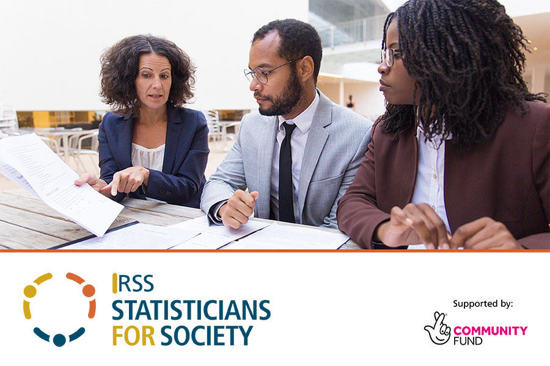
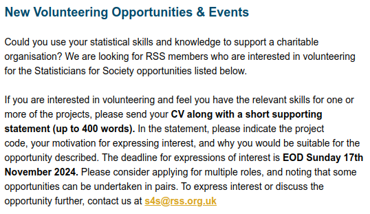
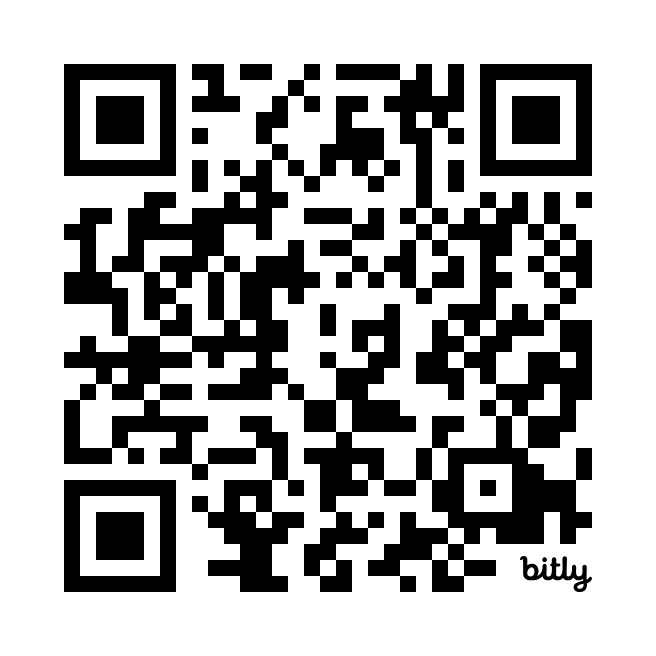

##

<!-- If you are looking for some opportunities different to traditional research, or want to put your knowledge and skills into good use, statisticians for society might pique your interest. -->

```{r setup}
#| echo: FALSE
#| message: FALSE
knitr::opts_chunk$set(fig.align = "center", echo = FALSE)
```

```{r rss-s4s}
#| echo: FALSE
#| out.width: "75%"

```

<!-- S4S is a scheme funded by the national lottery, and it connects RSS fellows with charities who can't afford a statistician or data scientist to crunch their numbers. Since 2017 the scheme has made over 100 matches. Most of them are completed, but there are projects ongoing. -->

## Sign up

<!-- Once you sign up to the scheme, using the QR code or link on the right, you will receive an email every month that looks like this with the opportunities listed below, and you apply to the projects like you apply for a job. There's a deadline this Sunday, so if you sign up now, you might get a project right away. -->

::: columns

:::: {.column width="70%"}
```{r opportunities}
#| echo: FALSE
#| out.width: "95%"

```
::::

:::: {.column width="30%"}
```{r s4s-signup}
#| echo: FALSE
#| out.width: "95%"
#| fig.align: "left"

```
https://bit.ly/s4s-signup
::::

:::

## The process

* Initial meeting with the charity

* Project proposal

* Mid-point review

* Report & wrap-up meeting

<!-- I won't go through the process in too much detail because of the time constraint, but want to point out that you are supported by others in the scheme throughout the project. For example, by the time the initial call takes place, the scheme will have already met with the charity to decide the suitability of the project, so you and the charity won't go into the meeting having a huge mismatch in your expectations. Also, during the project, you will get to chat with another fellow who's a reviewer of the project, just to make sure everything is on track. -->

## My project with Freegle

::: columns

:::: {.column width="50%"}

$$ ~ $$

- Online platform for exchanging items  
  * No money involved  
  * Donating stuff in a targeted manner

- What makes an exchange likely to happen?

- Case study: https://bit.ly/s4s-freegle

::::

:::: {.column width="50%"}
```{tikz, tikz-ex, out.width = "95%"}
\usetikzlibrary{shapes, arrows}
\tikzstyle{cloud} = [draw, ellipse, node distance = 4cm, minimum height = 2em]
\begin{tikzpicture}[node distance = 3cm, auto,>=latex', thick, scale = 0.5]
\node[cloud] (s) {$\texttt{Exchange probability}$};
\node[cloud] (r) [right of=s] {$\texttt{Rating}$};
\node[cloud] (n) [below of=s] {$\texttt{Number of messages}$};
\node[cloud] (d) [below of=r] {$\texttt{Distance}$};
\draw[->] (s) to node {} (r);
\draw[->] (n) to node {} (s);
\draw[->] (n) to node {} (r);
\draw[->] (d) to node {} (s);
\end{tikzpicture}
```
::::

:::

## Takeaway

::: columns

:::: {.column width="70%"}

$$ ~ $$

* Possible continuing collaboration

* Test & sharpen your skills

* Engagement / outreach

<!-- Unlike most of the projects which are self-contained, my project was quite open-ended, so I have continued collaborating with Freegle after the initial project was officially wrapped up with RSS. So chances are that you will discover new research and collaboration opportunities from this scheme. Even if you don't, it is an excellent opportunity to test and sharpen your skills and knowledge. Also, if your company or institution rewards engagement and outreach, S4S is a great starting point. -->
::::

:::: {.column width="30%"}

```{r s4s-signup}
#| echo: FALSE
#| out.width: "95%"
#| fig.align: "left"
```
https://bit.ly/s4s-signup

::::

:::
